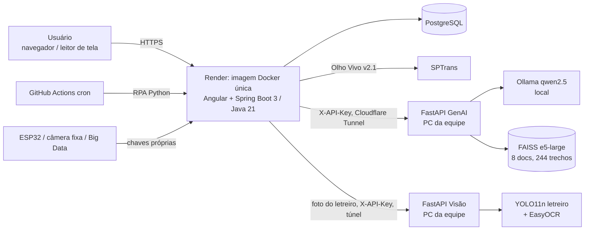

# Ponto Falante

Plataforma de acessibilidade para quem usa ônibus em São Paulo, pensada para pessoas com deficiência visual e idosos:
próximos ônibus previstos para um ponto, anúncio por voz, assistente que responde dúvidas sobre gratuidades e
bilhetes com base em fontes oficiais, e um boletim diário de espera prevista gerado por um robô (RPA).

Global Solution FIAP 2026.2 · Engenharia de Software.

- **Aplicação publicada:** https://ponto-falante.onrender.com
- **Repositório:** https://github.com/pedrobicas/ponto-falante
- **Vídeos de demonstração:** [Generative AI](https://youtu.be/8b0Vu1Txdq4) · [RPA](https://youtu.be/NPmEduM5GCY) ·
  [Visão Computacional](https://youtu.be/rMHjmrluxjI)

## Ficha técnica do MVP

Ficha comum da equipe, conforme o PDF oficial da FIAP, p. 20. Os indicadores abaixo são propostas de acompanhamento;
não representam impacto já medido com passageiros.

| Campo | Definição |
|---|---|
| Nome do produto | Ponto Falante |
| Cidadão e território | Usuários de ônibus municipais de São Paulo, especialmente pessoas com deficiência visual e idosos |
| Problema | Dificuldade de ler letreiros, consultar previsões e entender orientações de transporte com autonomia |
| Proposta de valor | Consulta acessível por texto e voz, com fontes e distinção entre previsão, estimativa e demonstração |
| Arquitetura | Angular, Spring Boot, PostgreSQL; GenAI local via FastAPI/Ollama; robôs Python em GitHub Actions |
| Fontes de dados | Cadastro GTFS e previsões Olho Vivo da SPTrans; documentos oficiais identificados em `genai/base/fontes.csv` |
| Modelos de IA | Produção: agente com `qwen2.5:7b` local; recuperação FAISS com embeddings multilíngues. Comparações e versões anteriores no relatório GenAI |
| URL e repositório | Links acima |
| Indicadores de impacto propostos | Proporção de consultas concluídas por voz; tempo para obter uma previsão; sucesso de uso com leitor de tela; compreensão da origem/data do boletim |
| ODS conectados | ODS 10 (redução das desigualdades) e ODS 11 (cidades e comunidades sustentáveis), pelo acesso à informação de mobilidade |

| Nome completo | RM |
|---|---|
| Pedro Henrique Bicas Couto | 99534 |
| Bryan Willian | 551305 |
| Felipe Masera Terra | 99405 |
| Gabriel Fernandes Doms | 98630 |
| Lucas Vassão Braga | 98607 |

## Situação atual (o que é real e o que é demonstração)

| Parte | Situação |
|---|---|
| Interface Angular (acessível, voz, 4 temas) | Publicada, servida pelo Spring Boot |
| Spring Boot + PostgreSQL (Flyway) | Publicado no Render (plano gratuito) |
| Previsões de ônibus | **Real**: dados da Olho Vivo (SPTrans) pelo gateway oficial da Prefeitura (apilib, OAuth2), marcados como "Dados da SPTrans" e sempre como previsão. O login direto da Olho Vivo recusa qualquer chave hoje ([diagnóstico](docs/DIAGNOSTICO_SPTRANS.md)). Sem credenciais, o sistema volta ao modo demonstração com o selo **SIMULADO**. |
| Boletim de espera prevista (RPA) | O coletor consulta pontos públicos da SPTrans em 8 janelas diárias; o robô diário está agendado para 6h (Brasília). O boletim declara **ESTIMADO**, **SIMULADO** ou **INDISPONIVEL**, data e cobertura. GitHub Actions pode atrasar ou pular janelas; previsão não mede atraso observado. |
| Assistente (GenAI) | Implementado e avaliado; roda no PC da equipe (Ollama + FastAPI) e só fica disponível no site quando o túnel Cloudflare estiver ligado. Sem ele, o chat avisa que está indisponível e o resto funciona. |
| Embarque assistido | Implementado: trajetos favoritos, ponto por GPS ou busca com confirmação, acompanhamento das previsões a cada 20 s com avisos por voz que não se repetem, assistente que executa as ações (com confirmação) e funciona sem a GenAI. [Detalhes](docs/EMBARQUE_ASSISTIDO.md) |
| Visão computacional (conferência do letreiro) | **Integrada**: o celular fotografa o letreiro e o modelo da equipe (YOLO11n treinado com ônibus de SP + EasyOCR, [pasta `visao/`](visao/README.md)) confere se é a linha esperada. O modelo precisa de ~1,5 GB de memória, então roda no PC da equipe (na CPU, de 3 a 6,5 s por foto) e entra no site pelo túnel, como a GenAI; com o PC desligado a tela diz "indisponível agora" e não abre a câmera. Nenhum resultado é simulado. [Detalhes](visao/INTEGRACAO.md) |
| Câmera fixa do ponto (visão) | `visao/src/demo.py --contrato mvp` envia ao MVP o que a câmera viu (`POST /api/integracoes/visao/deteccoes`, inclusive "ônibus sem linha lida"); a câmera do ponto é simulada com vídeo/fotos |
| Integrações Big Data e ESP32 | Endpoints e contratos prontos, protegidos por chave ([contrato](contratos/openapi-mvp.yaml)) |

Regras do produto: dado simulado nunca aparece como real; previsão nunca aparece como chegada observada.

Exemplos públicos: Avenida Paulista, 1374 (ponto `70016916`) e linha `875A-10`, conferidos no GTFS empacotado.
O cadastro oficial completo permanece intacto; exemplos e testes usam apenas locais públicos.

## Arquitetura



O navegador só fala com o Spring. As chaves (RPA, GenAI, dispositivos) ficam em variáveis de ambiente; nada sensível vai para o
repositório (Gitleaks na CI).

## Módulos

| Pasta | Conteúdo |
|---|---|
| `frontend/` | Angular 20, componentes standalone, signals; acessibilidade WCAG 2.2 AA (axe nos testes) |
| `backend/` | Spring Boot 3.5, Flyway, cliente Olho Vivo, chat, boletim, integrações, Actuator |
| `genai/` | Base de conhecimento, índice FAISS, RAG, agente v1/v2, avaliação e [relatório](genai/RELATORIO.md) |
| `rpa/` | Robô do boletim (Python), BPMN, testes, logs e [documentação](rpa/README.md) |
| `visao/` | Visão computacional: dataset, treino YOLO11n, OCR, métricas, [relatório](visao/resultados/Relatorio_Visao_Ponto_Falante.pdf) e o serviço HTTP usado pelo MVP ([integração](visao/INTEGRACAO.md)) |
| `contratos/` | OpenAPI público do MVP e contrato da API GenAI |
| `scripts/` | Execução local, testes de integração, SPTrans e scripts PowerShell do GenAI/túnel |
| `docs/` | Arquitetura, embarque assistido, SPTrans e evidências de testes em produção |

## GenAI em uma tabela

Teste final (46 perguntas inéditas, mesmo `qwen2.5:7b` em todas as configurações, rodado uma única vez), conforme a
Tabela 8 do [relatório da GenAI](genai/RELATORIO.md):

| Configuração | Acerto | Recusa indevida | Recusa correta | Erros factuais/pergunta |
|---|---|---|---|---|
| Sem contexto | 8,7% | 0,0% | 15,4% | 34,8% |
| RAG simples | 65,2% | 9,1% | 69,2% | 15,2% |
| **RAG com agente (padrão do produto)** | **65,2%** | 21,2% | **84,6%** | **8,7%** |

O contexto multiplicou o acerto e reduziu os erros factuais em relação ao mesmo modelo sem contexto. O agente empatou
com o RAG em acerto e errou menos, por isso é o padrão do produto: quem ouve a resposta nem sempre consegue conferi-la.
Variações testadas depois e a análise completa estão no [registro técnico da GenAI](genai/docs/REGISTRO_TECNICO.md).

## Ligar o site publicado com um clique (PC da equipe)

O site em https://ponto-falante.onrender.com fica sempre no ar, mas o assistente (LLM local) e a conferência do
letreiro pela câmera rodam no PC da equipe e chegam ao Render por túneis gratuitos da Cloudflare. No Windows, dê dois
cliques em **`INICIAR_PONTO_FALANTE.bat`** (raiz do repositório): ele confere as dependências, acorda o Render, sobe
Ollama + modelo, a API da GenAI, o serviço de visão, os dois túneis, registra os endereços no site, roda o robô RPA e
mostra o estado de cada peça. **`STATUS_PONTO_FALANTE.bat`** repete a conferência com um teste de ponta a ponta pelo
site, e **`PARAR_PONTO_FALANTE.bat`** desliga tudo. O PC precisa ficar ligado e conectado durante a avaliação; detalhes
em [scripts/ponto_falante/README.md](scripts/ponto_falante/README.md).

## Executar localmente

Sem Docker (JDK 21, Node 22+, Python 3.11+):

```powershell
python -m venv .venv
.\.venv\Scripts\python.exe -m pip install -r rpa/requirements.txt
.\.venv\Scripts\python.exe scripts/integracao/rodar_mvp_local.py --build
```

Abra http://127.0.0.1:8080. O launcher compila o Angular, roda os testes do Spring, empacota o JAR e sobe um PostgreSQL local
em `.validation/local/` (ignorado pelo Git).

Com Docker:

```powershell
if (-not (Test-Path .env)) { Copy-Item .env.example .env }   # preencha POSTGRES_PASSWORD, PF_SALT e RPA_API_KEY
docker compose up --build
docker compose --profile rpa run --rm rpa                    # publica um boletim
```

Assistente real: [scripts/genai/README.md](scripts/genai/README.md) (Ollama + API local + túnel; a mesma `GENAI_API_KEY` no Spring).
Visão real: [visao/INTEGRACAO.md](visao/INTEGRACAO.md) (`scripts/visao/instalar.ps1` uma vez, depois `scripts/visao/iniciar.ps1 -TunelRapido`).

## Testes

```powershell
Push-Location backend; .\mvnw.cmd -B verify; Pop-Location                 # 225 testes, PostgreSQL embutido
Push-Location frontend; npm.cmd ci; npm.cmd test -- --watch=false; Pop-Location   # 79 testes (axe)
Push-Location genai; ..\.venv\Scripts\python.exe -m pytest -q tests; Pop-Location # 155 testes
Push-Location rpa; ..\.venv\Scripts\python.exe -m pytest -q; Pop-Location         # 53 testes
Push-Location visao; ..\.venv-visao\Scripts\python.exe -m pytest -q; Pop-Location # visão (PF_VISAO_TESTE_REAL=1 inclui o modelo real)
.\.venv\Scripts\python.exe -m pytest -q tests/integracao                          # 26 testes
.\.venv\Scripts\python.exe scripts/integracao/testar_mvp.py --url https://ponto-falante.onrender.com
.\.venv\Scripts\python.exe scripts/integracao/validar_embarque.py   # E2E do embarque (Playwright, desktop e celular)
.\.venv-visao\Scripts\python.exe scripts/integracao/validar_visao.py # E2E da conferência pela câmera com o modelo real
```

## CI/CD e segurança

A cada push, o GitHub Actions roda: Gitleaks (segredos no histórico), Semgrep (SAST, OWASP Top 10), testes Python, Spring
com PostgreSQL, Angular com acessibilidade, build da imagem Docker, Trivy (dependências e imagem, HIGH/CRITICAL) e um
teste de fumaça da imagem com PostgreSQL. O Render só publica depois que todos os checks passam
(`autoDeployTrigger: checksPass`). Exceções de scanner são justificadas em `.gitleaks.toml`, `.semgrepignore`,
comentários `nosemgrep` e `.trivyignore`.

Proteções do MVP: chaves por integração com comparação em tempo constante, rotas normalizadas antes da autorização,
limite de perguntas por usuário (IP resolvido só via proxy confiável), cota individual pseudônima e capacidade global na
GenAI, logs sem texto de pergunta (LGPD), imagem com usuário não root, health checks no Actuator.

Plano gratuito do Render: o serviço dorme após 15 min sem acesso (cerca de 1 min para acordar) e o PostgreSQL gratuito
expira 30 dias após a criação. A configuração do serviço está em [render.yaml](render.yaml).

## Documentos

[Arquitetura](docs/ARQUITETURA.md) · [SPTrans](docs/SPTRANS.md) · [Relatório GenAI](genai/RELATORIO.md) ·
[RPA](rpa/README.md) · [Visão](visao/README.md) · [Contrato público](contratos/openapi-mvp.yaml) · [Evidências](docs/EVIDENCIAS.md)
