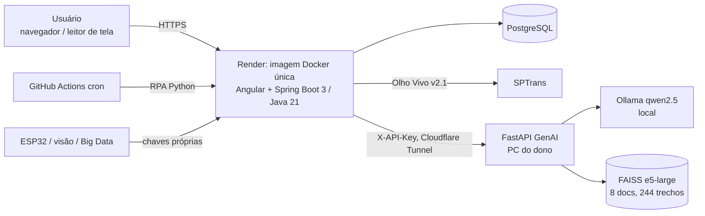

# Ponto Falante

Plataforma de acessibilidade para quem usa ônibus em São Paulo, pensada para pessoas com deficiência visual e idosos:
próximos ônibus previstos para um ponto, anúncio por voz, assistente que responde dúvidas sobre gratuidades e
bilhetes com base em fontes oficiais, e um boletim diário de espera prevista gerado por um robô (RPA).

Global Solution FIAP 2026.2 · Engenharia de Software.

- **Aplicação publicada:** https://ponto-falante.onrender.com
- **Repositório:** https://github.com/pedrobicas/ponto-falante

| Nome completo | RM |
|---|---|
| Pedro Henrique Bicas Couto | 99534 |
| Bryan Willian | 551305 |
| Felipe Masera Terra | 99405 |
| Gabriel Fernandes Doms | 98630 |
| Lucas Vassão Braga | 98607 |

## Situação atual (o que é real e o que é demonstração)

| Parte | Situação |
|---|---|
| Interface Angular (acessível, voz, 4 temas) | Publicada, servida pelo Spring Boot |
| Spring Boot + PostgreSQL (Flyway) | Publicado no Render (plano gratuito) |
| Previsões de ônibus | **Real**: dados da Olho Vivo (SPTrans) pelo gateway oficial da Prefeitura (apilib, OAuth2), marcados como "Dados da SPTrans" e sempre como previsão. O login direto da Olho Vivo recusa qualquer chave hoje ([diagnóstico](docs/DIAGNOSTICO_SPTRANS.md)). Sem credenciais, o sistema volta ao modo demonstração com o selo **SIMULADO**. |
| Boletim de espera prevista (RPA) | O coletor consulta pontos públicos da SPTrans em 8 janelas diárias; o robô diário está agendado para 6h (Brasília). O boletim declara **ESTIMADO**, **SIMULADO** ou **INDISPONIVEL**, data e cobertura. GitHub Actions pode atrasar ou pular janelas; previsão não mede atraso observado. |
| Assistente (GenAI) | Implementado e avaliado; roda no PC do dono (Ollama + FastAPI) e só fica disponível no site quando o túnel Cloudflare estiver ligado. Sem ele, o chat avisa que está indisponível e o resto funciona. |
| Integrações visão computacional, Big Data e ESP32 | Endpoints e contratos prontos, protegidos por chave ([contrato](contratos/openapi-mvp.yaml)) |

Regras do produto: dado simulado nunca aparece como real; previsão nunca aparece como chegada observada.

Exemplos públicos: Avenida Paulista, 1374 (ponto `70016916`) e linha `875A-10`, conferidos no GTFS empacotado.
O cadastro oficial completo permanece intacto. Exemplos e evidências de demonstração não devem usar referências
à residência dos integrantes. A lista da assistente, os testes e os roteiros seguem essa regra.

Entrega FIAP: [critérios e pendências](docs/REVISAO_CRITERIOS.md), [roteiro GenAI](genai/ROTEIRO_VIDEO.md)
e [roteiro RPA](rpa/docs/roteiro_video.md). Não repetir os conjuntos finais fechados para gravar uma demonstração.

## Arquitetura



O navegador só fala com o Spring. As chaves (RPA, GenAI, dispositivos) ficam em variáveis de ambiente; nada sensível vai para o
repositório (Gitleaks na CI).

## Módulos

| Pasta | Conteúdo |
|---|---|
| `frontend/` | Angular 20, componentes standalone, signals; acessibilidade WCAG 2.2 AA (axe nos testes) |
| `backend/` | Spring Boot 3.5, Flyway, cliente Olho Vivo, chat, boletim, integrações, Actuator |
| `genai/` | Base de conhecimento, índice FAISS, RAG, agente v1/v2, avaliação e [relatório](genai/RELATORIO.md) |
| `rpa/` | Robô do boletim (Python), BPMN, testes, logs e [documentação](rpa/README.md) |
| `contratos/` | OpenAPI público do MVP e contrato da API GenAI |
| `scripts/` | Execução local, testes de integração, SPTrans e scripts PowerShell do GenAI/túnel |
| `docs/` | Arquitetura, revisão dos critérios, integração, deploy e diagnóstico SPTrans |

## GenAI em uma tabela

Teste inédito (40 perguntas, rodado uma única vez, adjudicado às cegas):

| Configuração | Acerto | Recusa indevida | Erros factuais/pergunta |
|---|---|---|---|
| RAG v1 (qwen2.5:3b) | 47,5% | 3,3% | 27,5% |
| Agente v1 (padrão do produto) | 47,5% | 66,7% | 0,0% |
| Agente v2 (qwen2.5:7b) | 55,0% | 20,0% | 15,0% |

No desenvolvimento a v2 chegou a 93,3%; a queda no inédito está analisada na [seção 11 do relatório](genai/RELATORIO.md).
O produto usa o agente v1 por padrão (não errar é prioridade para quem ouve a resposta); `PF_MODO=v2` ativa a v2.

## Executar localmente

Sem Docker (JDK 21, Node 22+, Python 3.11+):

```powershell
python -m venv .venv
.\.venv\Scripts\python.exe -m pip install -r rpa/requirements.txt
.\.venv\Scripts\python.exe scripts/integracao/rodar_mvp_local.py --build
```

Abra http://127.0.0.1:8080. O launcher compila o Angular, roda os testes do Spring, empacota o JAR e sobe um PostgreSQL local
em `.validation/local/` (ignorado pelo Git).

Com Docker:

```powershell
if (-not (Test-Path .env)) { Copy-Item .env.example .env }   # preencha POSTGRES_PASSWORD, PF_SALT e RPA_API_KEY
docker compose up --build
docker compose --profile rpa run --rm rpa                    # publica um boletim
```

Assistente real: [scripts/genai/README.md](scripts/genai/README.md) (Ollama + API local + túnel; a mesma `GENAI_API_KEY` no Spring).

## Testes

```powershell
Push-Location backend; .\mvnw.cmd -B verify; Pop-Location                 # 172 testes, PostgreSQL embutido
Push-Location frontend; npm.cmd ci; npm.cmd test -- --watch=false; Pop-Location   # 47 testes (axe)
Push-Location genai; ..\.venv\Scripts\python.exe -m pytest -q tests; Pop-Location # 155 testes
Push-Location rpa; ..\.venv\Scripts\python.exe -m pytest -q; Pop-Location         # 46 testes
.\.venv\Scripts\python.exe -m pytest -q tests/integracao                          # 26 testes
.\.venv\Scripts\python.exe scripts/integracao/testar_mvp.py --url https://ponto-falante.onrender.com
```

## CI/CD e segurança

A cada push, o GitHub Actions roda: Gitleaks (segredos no histórico), Semgrep (SAST, OWASP Top 10), testes Python, Spring
com PostgreSQL, Angular com acessibilidade, build da imagem Docker, Trivy (dependências e imagem, HIGH/CRITICAL) e um
teste de fumaça da imagem com PostgreSQL. O Render só publica depois que todos os checks passam
(`autoDeployTrigger: checksPass`). Exceções de scanner são justificadas em `.gitleaks.toml`, `.semgrepignore`,
comentários `nosemgrep` e `.trivyignore`.

Proteções do MVP: chaves por integração com comparação em tempo constante, rotas normalizadas antes da autorização,
limite de perguntas por usuário (IP resolvido só via proxy confiável), cota individual pseudônima e capacidade global na
GenAI, logs sem texto de pergunta (LGPD), imagem com usuário não root, health checks no Actuator.

Plano gratuito do Render: o serviço dorme após 15 min sem acesso (cerca de 1 min para acordar) e o PostgreSQL gratuito
expira 30 dias após a criação. Detalhes em [docs/PRIMEIRO_DEPLOY.md](docs/PRIMEIRO_DEPLOY.md).

## Documentos

[Arquitetura](docs/ANALISE_E_ARQUITETURA.md) · [Revisão dos critérios FIAP](docs/REVISAO_CRITERIOS.md) ·
[Integração do MVP](docs/INTEGRACAO_MVP.md) · [SPTrans](docs/SPTRANS.md) · [Relatório GenAI](genai/RELATORIO.md) ·
[RPA](rpa/README.md) · [Contrato público](contratos/openapi-mvp.yaml) · [Evidências](docs/EVIDENCIAS.md)
