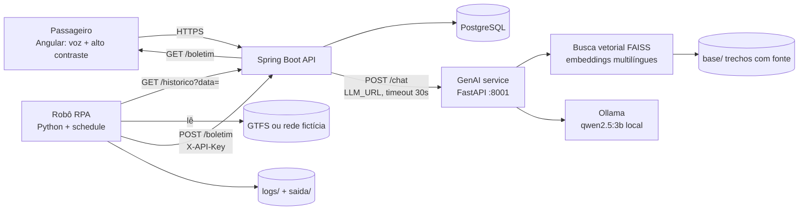

# Ponto Falante · Arquitetura

Visão geral de como as partes do Ponto Falante se conectam. Os números de modelo, limiar e testes mais recentes
estão nos READMEs de cada módulo ([GenAI](../genai/README.md), [RPA](../rpa/README.md), [Visão](../visao/README.md));
esta página registra o desenho e as decisões.

## 1. O que cada módulo resolve

| Módulo | Pergunta do cidadão / tarefa | Saída consumida pelo MVP |
|---|---|---|
| **GenAI · Inteligência** | "Tenho 62 anos, pago a passagem?", "Como peço o cartão especial?", "Quanto tempo vale a integração do Bilhete Único?" | `POST /chat` → JSON com resposta curta, fontes citadas, confiança e `nao_consta` |
| **RPA · Automação** | Hoje alguém teria de acompanhar as linhas, anotar atrasos, comparar com o programado e avisar passageiros. O robô faz isso todo dia. | Boletim diário (JSON + HTML em linguagem simples) publicado no backend → `GET /boletim` |

## 2. Decisão de stack

O MVP do grupo é **Angular + Spring Boot + PostgreSQL**; GenAI, RPA e Visão se conectam a ele por HTTP. Consequência:

- O **Spring Boot é o único ponto de entrada** do Angular. Ele expõe todos os endpoints do contrato (`/pontos`, `/previsoes`, `/chat`, `/boletim`, `/historico`, `/status`, `/health`).
- O **GenAI é um microsserviço Python** (FastAPI + Ollama) que o Spring chama por HTTP via variável `LLM_URL`. O navegador nunca fala com o Ollama.
- O **RPA é um job Python agendado** que lê `GET /historico` do Spring e publica com `POST /boletim` (endpoint novo, autenticado por chave em variável de ambiente).
- Integração por contrato HTTP, não por prints.



## 3. Contratos de integração com o Spring Boot

Arquivo de referência: `contratos/openapi-integracao.yaml`.

### 3.1 `POST /chat` (Spring → GenAI)

Requisição: `{"pergunta": "string (1–500 caracteres)"}`
Sem identificador de usuário, sem histórico guardado (LGPD by design).

Resposta 200:
```json
{
  "resposta": "Sim. Pessoas com 60 anos ou mais não pagam a tarifa nos ônibus municipais de São Paulo...",
  "fontes": [{"documento": "SPTrans · Gratuidades", "trecho_id": "sptrans-gratuidade-003"}],
  "confianca": "alta",
  "nao_consta": false
}
```
Regras: `nao_consta=true` ⇒ `fontes=[]` e resposta padrão "Não encontrei essa informação nas fontes oficiais que tenho...". O Spring repassa o corpo sem alterar. Se o serviço cair ou passar do timeout, o Spring responde 200 com `{"resposta": "O assistente está indisponível agora. Tente de novo em instantes.", "fontes": [], "confianca": "baixa", "nao_consta": true}` (degradar com elegância).

Extras opcionais na resposta (o Spring pode ignorar): `"modo"`, `"latencia_ms"`.

### 3.2 `GET /historico?data=YYYY-MM-DD` (RPA → Spring)

Lista de passagens do dia, de qualquer fonte: o mesmo objeto `previsao` do contrato comum + `veiculo` (identificador já anonimizado/hash), necessário para remover duplicados (mesmo veículo, mesmo ponto, mesmo minuto).
```json
[{"ponto":"PF-0001","linha":"8000-10","sentido":"Terminal Lapa","veiculo":"a1f3...",
  "programado_em":"07:10","previsto_em":"07:18","minutos":0,"acessivel":true,
  "fonte":"simulador","atualizado_em":"2026-11-12T07:18:05-03:00"}]
```
Se `veiculo` não vier, o robô deduplica por (linha, ponto, minuto) e registra no log.

### 3.3 `POST /boletim` (RPA → Spring) e `GET /boletim` (Angular → Spring)

Cabeçalho `X-API-Key: ${RPA_API_KEY}` (variável de ambiente nos dois lados, nunca no código). O Spring guarda o JSON (tabela `boletim`, coluna `jsonb`, chave `data_referencia`, upsert) e `GET /boletim` devolve o mais recente.
```json
{
  "data_referencia": "2026-11-12",
  "gerado_em": "2026-11-13T06:00:04-03:00",
  "desatualizado": false,
  "motivo_desatualizado": null,
  "fonte_dados": {"olhovivo": 0, "simulador": 412},
  "parametros": {"atraso_critico_min": 10, "atraso_atencao_min": 5, "intervalo_critico_min": 30, "intervalo_atencao_min": 20},
  "estatisticas": {"recebidos": 430, "validos": 400, "invalidos": 18, "duplicados": 12},
  "invalidos_por_motivo": {"linha_inexistente": 6, "horario_incoerente": 9, "campo_vazio": 3},
  "linhas": [{"linha": "8000-10", "status": "CRITICA", "atraso_medio_min": 12.4, "intervalo_max_min": 34,
              "passagens": 41, "frase": "Linha 8000-10: atrasos fortes, em média 12 minutos."}],
  "resumo_falado": "Boletim de 12 de novembro. 1 linha com atraso forte...",
  "html": "<section>...</section>"
}
```
Se `POST /boletim` falhar após as tentativas, o robô salva em `saida/` e registra a falha. Quando o histórico do dia não puder ser lido, republica o último boletim com `desatualizado=true` e o motivo.

## 4. GenAI · desenho técnico (ciclo inicial)

| Item | Escolha | Por quê |
|---|---|---|
| LLM | **Ollama + qwen2.5:3b** (Q4, ~1,9 GB) | Local e gratuito, melhor português entre os 3B sugeridos, roda em CPU ou na RX 7600 |
| Embeddings | `intfloat/multilingual-e5-large` via fastembed (ONNX) | Multilíngue, gratuito, sem PyTorch. Escolhido no conjunto de desenvolvimento contra MiniLM e mpnet (recall@3 1,00 × 0,65 × 0,60) |
| Índice | FAISS (`IndexFlatIP`, cosseno) | Base pequena, busca exata |
| Validação | pydantic v2 + `format=json` do Ollama | JSON sempre válido; se inválido, 1 nova tentativa e depois recusa |
| Especialização | **Agente** (não LoRA) | Ver abaixo |

**Por que agente e não LoRA:** treinar LoRA de um 3B exige GPU NVIDIA (Colab T4) e um conjunto de treino maior do que o prazo permitia; a GPU AMD no Windows não roda o ecossistema de treino. O agente é avaliável no mesmo placar e ataca diretamente as causas de alucinação. Pipeline do agente:
1. **Classificar** a pergunta (escopo transporte / fora de escopo) → fora de escopo recusa sem gastar geração.
2. **Reescrever** a consulta em termos da base (ex.: "velhinho" → "pessoa idosa 60 anos gratuidade").
3. **Buscar** top-k com limiar; se nada passar do limiar → `nao_consta`.
4. **Gerar** resposta curta em JSON citando `trecho_id`.
5. **Verificar**: cada `trecho_id` citado existe entre os recuperados e a resposta é sustentada pelo trecho (checagem pelo próprio LLM); senão, regenera uma vez ou recusa.

**Separação desenvolvimento × teste:** todas as escolhas (embeddings, limiar 0,86, ajustes do agente) usam `avaliacao/perguntas_dev.jsonl` (30 perguntas); o teste final `avaliacao/perguntas.jsonl` (40) é rodado uma única vez, depois de congelar o agente.

**Três configurações do placar (critério 06):** (A) modelo sem contexto, (B) RAG simples, (C) RAG + agente. Métricas sobre ~40 perguntas com gabarito: acerto (resposta correta), alucinação (afirma algo fora do gabarito/da base), recusa correta em perguntas "não consta", JSON válido, citação correta, latência média.

**Base de conhecimento (só documentos públicos):**
- Lei 10.741/2003 (Estatuto da Pessoa Idosa), artigos de transporte (arts. 39 a 42), no site do Planalto.
- Lei 13.146/2015 (Lei Brasileira de Inclusão), capítulo do transporte e mobilidade (arts. 46 a 52), no site do Planalto.
- Páginas da SPTrans sobre tarifas, gratuidades (idoso, pessoa com deficiência), Bilhete Único e integração.
Cada URL foi conferida antes do download, com data de acesso e licença na tabela da base (`genai/base/fontes.csv`). Tarifa e prazos vêm só do texto baixado.

**Estrutura da pasta `genai/`:**
```
genai/
  notebooks/   01_base.ipynb 02_indice_recall.ipynb 03_geracao.ipynb 04_agente_placar.ipynb (com saídas)
  base/        brutos/ trechos.jsonl fontes.csv
  avaliacao/   perguntas.jsonl placar.csv erros.md
  api/         app.py (POST /chat, GET /health)
  src/pf_genai/  chunking, indice, gerador, agente, esquemas
  tests/       testes do contrato e da recusa
  README.md  RELATORIO.md  requirements.txt
```

## 5. RPA · desenho técnico

Python 3.11 + `requests` (com retry/backoff), `pyyaml`, `jinja2`, `schedule`, `pytest`. Python foi escolhido porque versiona e testa melhor que UiPath/Power Automate.

Fluxo em 8 etapas:
1. **Entrada:** `config/monitoramento.yaml` (linhas, pontos, limites X/Y, URL do MVP) + GTFS (`routes.txt`, `stop_times.txt`) ou rede fictícia.
2. **Coleta:** `GET /historico?data=` com 3 tentativas e backoff exponencial.
3. **Repetição + validação:** para cada registro, valida linha existente, horário coerente (previsto não antes do programado em mais de 60 min; formato HH:MM), campos obrigatórios. Inválidos vão para lista com motivo.
4. **Deduplicação:** (veículo, ponto, minuto).
5. **Decisão por linha:** atraso médio > X **ou** intervalo entre ônibus > Y ⇒ CRÍTICA; entre limites ⇒ ATENÇÃO; senão OK. Limites iniciais (hipóteses documentadas): X = 10 / 5 min, Y = 30 / 20 min.
6. **Saída:** boletim JSON + HTML acessível com frases curtas para leitura em voz; `POST /boletim`.
7. **Exceções:** MVP fora (retry → boletim anterior marcado como desatualizado), GTFS ausente/inválido (cai para rede fictícia e avisa no boletim), dados inconsistentes (registrados por motivo), falha de publicação (salva local e sai com código de erro). Nenhuma falha silenciosa.
8. **Logs:** arquivo diário em `logs/` com data/hora, recebidos, válidos, inválidos por motivo, duplicados, linhas por status, sucesso/falha e mensagens de erro, sem chave nem dado pessoal (o veículo já vem em hash).

Testes (`tests/`): sucesso ponta a ponta contra um mock do backend; decisão CRÍTICA × ATENÇÃO × OK; falha com API fora (boletim desatualizado); GTFS ausente; duplicados e inválidos.

**Pessoa no circuito (IA responsável):** o robô sinaliza; o boletim diz "linhas para a equipe da gestora verificar" e os limites ficam em configuração, editáveis por uma pessoa.

**Estrutura da pasta `rpa/`:**
```
rpa/
  README.md  requirements.txt
  config/     monitoramento.yaml
  src/pf_rpa/ coleta, validacao, decisao, boletim, publicacao, robo (orquestrador), agendador
  tools/      mock_mvp.py (imita o Spring Boot para testes e demo sem backend)
  docs/       fluxo.bpmn, fluxo.png, relatorio.md (base do relatório)
  assets/     prints e evidências
  logs/       amostras sem dados sensíveis
  tests/      pytest dos 3+ cenários
```

## 6. Visão computacional

YOLO11n treinado com duas classes (`onibus` e `letreiro`) e EasyOCR sobre o recorte do letreiro, com a leitura validada
contra as linhas que passam no ponto. O modelo roda num serviço FastAPI (`visao/servico`) no PC da equipe, exposto por um
Cloudflare Quick Tunnel; o Spring Boot recebe a foto do celular, envia ao serviço com as linhas acompanhadas e devolve
`CONFERE`, `NAO_CONFERE` ou `INCONCLUSIVO`. Detalhes em [`visao/INTEGRACAO.md`](../visao/INTEGRACAO.md).

