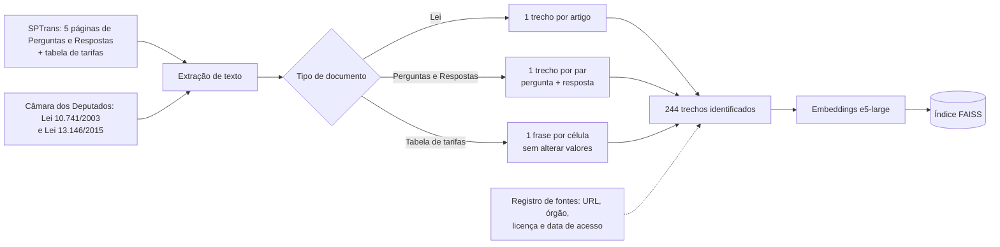
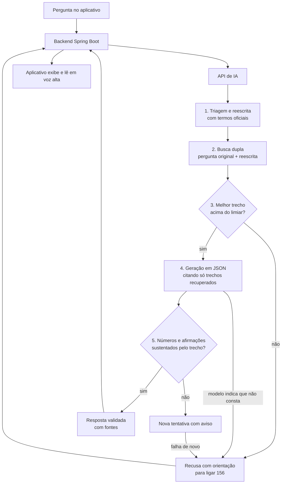
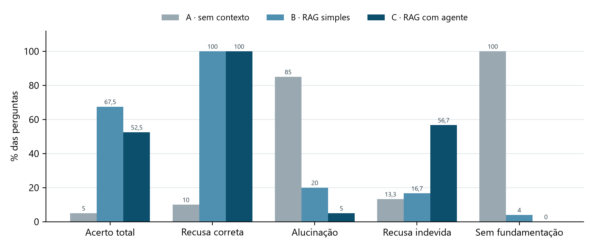

# Ponto Falante: assistente de direitos no transporte com IA generativa local

Relatório técnico · Generative AI for Engineering · FIAP · Engenharia de Software, 4º ano · Global Solution 2026.2 ·
CitizenTech · Tema: mobilidade · Novembro de 2026

## 1. Integrantes

| Nome completo | RM |
|---|---|
| Pedro Henrique Bicas Couto | 99534 |
| Bryan Willian | 551305 |
| Felipe Masera Terra | 99405 |
| Gabriel Fernandes Doms | 98630 |
| Lucas Vassão Braga | 98607 |

## 2. Ficha técnica

O Ponto Falante é uma plataforma de acessibilidade para passageiros de ônibus da cidade de São Paulo, pensada
principalmente para pessoas com deficiência visual e pessoas idosas. Além das previsões de chegada, o aplicativo tem um
assistente que responde, em linguagem simples e com leitura em voz alta, dúvidas sobre gratuidade, Bilhete Único,
integração e direitos no transporte. É nesse assistente que entra a IA generativa.

| Item | Descrição |
|---|---|
| Problema | As regras de gratuidade e de uso do Bilhete Único estão espalhadas por dezenas de páginas de perguntas e respostas da SPTrans e por leis federais, num formato difícil de consultar com leitor de tela. |
| O que a IA resolve | Responde em até três frases curtas, próprias para leitura em voz alta, usando somente documentos oficiais. Cada resposta cita o trecho usado. Quando a base não traz a informação, o assistente recusa e orienta a confirmar no 156. |
| Usuário | Passageiro de ônibus de São Paulo, pelo aplicativo Ponto Falante (Angular), por meio do backend Spring Boot. |
| Modelo de linguagem | `qwen2.5:7b` (Alibaba Qwen, licença Apache 2.0), executado localmente no Ollama, com temperatura 0, semente 42 e contexto de 4.096 tokens. O primeiro ciclo de experimentos usou o `qwen2.5:3b`. |
| Embeddings e índice | `intfloat/multilingual-e5-large` (MIT) e índice FAISS de produto interno sobre vetores normalizados (similaridade de cosseno), com 244 trechos. |
| Especialização | Agente com triagem, busca, geração estruturada e verificação, comparado ao RAG simples (seção 6). |
| Saída | JSON validado com pydantic: `{resposta, fontes[{documento, trecho_id}], confianca, nao_consta}`. |
| Serviço | API FastAPI (`POST /chat`, `GET /health`), autenticada por chave e chamada pelo backend do MVP. |
| Custo | Modelo local, sem cobrança por token. |
| LGPD | A API não grava perguntas, endereços IP nem identificadores. A base contém apenas documentos públicos. |

## 3. Tarefa da IA e conjuntos de avaliação

A tarefa é de **pergunta e resposta fundamentada**: dada uma pergunta de um passageiro, responder com base nos trechos
oficiais, citar a fonte e recusar quando a resposta não está na base. Por isso, todo conjunto de avaliação mistura
perguntas respondíveis e perguntas **"não consta"**, cuja resposta correta é a recusa. Algumas das "não consta" são
armadilhas do mesmo assunto, como a validade do cartão de pessoa com deficiência, que a base não informa.

Cada pergunta tem gabarito: categoria, trechos esperados, grupos de fatos obrigatórios (com variações aceitas) e uma
resposta de referência. Desenvolvimento e teste foram mantidos separados desde o início.

Tabela 1. Conjuntos de perguntas com gabarito

| Conjunto | Perguntas | Uso |
|---|---|---|
| Desenvolvimento do 1º ciclo | 30 (20 respondíveis e 10 "não consta") | Todas as escolhas do 1º ciclo: embeddings, limiar e ajustes do agente |
| Teste do 1º ciclo | 40 (30 respondíveis e 10 "não consta") | Rodado uma única vez, depois de congelar as configurações |
| Desenvolvimento ampliado | 108 (80 respondíveis e 28 a recusar) | Ajustes posteriores com o modelo de 7B |
| Teste final | 46 (33 respondíveis e 13 a recusar) | Escrito à parte, sem acesso ao código, aos resultados nem ao desenvolvimento; congelado por hash e rodado uma única vez |

Nenhum trecho esperado do teste aparece no desenvolvimento. Uma primeira rodada exploratória chegou a usar o teste do
1º ciclo para escolher o limiar; ela foi descartada, as escolhas foram refeitas no desenvolvimento e os arquivos foram
mantidos à parte por transparência.

## 4. Arquitetura e pipelines

### 4.1 Pipeline dos documentos

Figura 1. Montagem da base de conhecimento

A segmentação respeita a estrutura de cada documento. Leis são divididas por artigo; perguntas e respostas da SPTrans
viram um trecho por par; a tabela de tarifas vira uma frase por célula, sem alterar nenhum valor. Cada trecho recebe um
identificador estável, que é o que a resposta cita.

### 4.2 Pipeline de resposta (agente)

Figura 2. Fluxo de uma pergunta no agente usado pelo produto

As configurações comparadas compartilham o mesmo modelo, o mesmo índice e o mesmo limiar:

- **A · sem contexto:** o modelo responde só com a pergunta.
- **B · RAG simples:** busca dos três melhores trechos, limiar de recusa, geração em JSON e validação.
- **C · RAG com agente:** o fluxo da Figura 2.

## 5. Base de conhecimento

Tabela 2. Fontes da base de conhecimento (acesso em 11/11/2026)

| Fonte | Formato | Licença | Trechos |
|---|---|---|---|
| SPTrans · Perguntas e Respostas · Bilhete Único Especial da Pessoa Idosa (65+) | HTML | Conteúdo público institucional; uso acadêmico com citação | 28 |
| SPTrans · Perguntas e Respostas · Gratuidade de 60 a 64 anos | HTML | idem | 33 |
| SPTrans · Perguntas e Respostas · Bilhete Único Especial da Pessoa com Deficiência | HTML | idem | 60 |
| SPTrans · Perguntas e Respostas · Bilhete Único (tipos, integração e uso) | HTML | idem | 52 |
| SPTrans · Perguntas e Respostas · Bilhete Único de Estudante | HTML | idem | 47 |
| SPTrans · Tarifas vigentes (atualizadas em 06/01/2026) | HTML | idem | 6 |
| Lei 10.741/2003, Estatuto da Pessoa Idosa · arts. 1º e 39 a 42 | HTML | Domínio público (Lei 9.610/98, art. 8º, IV) | 6 |
| Lei 13.146/2015, Lei Brasileira de Inclusão · arts. 2º e 46 a 52 | HTML | Domínio público (Lei 9.610/98, art. 8º, IV) | 12 |
| **Total** | | | **244** |

As leis foram obtidas no portal da Câmara dos Deputados. Da Lei 13.146/2015 foi usada a publicação original, porque a
versão consolidada não estava acessível no período da coleta; os artigos sobre transporte usados nas respostas não
tiveram mudança relevante.

## 6. Especialização: agente em vez de LoRA

O enunciado permite especializar o modelo com LoRA ou com um agente. Escolhemos o agente por dois motivos. O primeiro é
prático: o ajuste fino com LoRA exigiria GPU NVIDIA e centenas de pares revisados, e a máquina da equipe tem GPU AMD.
O segundo é técnico e mais importante: os erros do RAG simples no desenvolvimento não vinham de falta de conhecimento
do modelo, e sim de busca errada com perguntas coloquiais, citações inválidas, números inventados e afirmações que o
trecho não sustenta. Um ajuste de pesos não resolveria esses problemas; um fluxo com verificação, sim.

Tabela 3. Problemas observados no RAG simples e a etapa do agente que trata cada um

| Problema do RAG simples | Etapa do agente |
|---|---|
| Perguntas coloquiais ("velhinho", "passe livre", "quanto tá a passagem") | Triagem reescreve com os termos oficiais e a busca usa as duas versões |
| Citação de identificador inexistente | JSON Schema restringe a citação aos trechos recuperados |
| Valor, idade ou prazo inventado | Todo número da resposta precisa aparecer no trecho citado |
| Afirmação que o trecho não sustenta | Verificação por um segundo passo do modelo e uma nova tentativa; persistindo, recusa |
| Recusa com o trecho certo em primeiro lugar | Nova tentativa só com esse trecho quando ele passa do limiar com folga (reparo de recusa) |

## 7. Metodologia e métricas

As métricas são determinísticas e calculadas por código a partir do gabarito, de modo que qualquer pessoa pode
reproduzir o placar.

Tabela 4. Métricas usadas na avaliação

| Métrica | Definição |
|---|---|
| Acerto | Respondível: respondeu e trouxe todos os grupos de fatos obrigatórios. "Não consta": recusou. |
| Recusa correta | Percentual das perguntas "não consta" que foram recusadas. |
| Alucinação | Respondeu uma "não consta", ou respondeu uma respondível sem os fatos do gabarito. |
| Erro factual | Resposta com valor, prazo ou regra contrária ao gabarito (usada nos ciclos com o modelo de 7B). |
| Recusa indevida | Percentual das respondíveis que foram recusadas. |
| Sem fundamentação | Resposta afirmativa sem citação válida, ou com número ausente dos trechos citados. |
| Citação correta e precisão | Respostas que citaram ao menos um trecho esperado e proporção de citações pertinentes. |
| JSON válido | Saída aceita pelo validador no formato do contrato. |

A recusa é julgada pelo texto que será falado ao passageiro, e não apenas pelo campo `nao_consta`.

## 8. Resultados

### 8.1 Recuperação: recall e limiar

O modelo de embeddings foi escolhido no conjunto de desenvolvimento, com as 20 perguntas respondíveis:

Tabela 5. Comparação de modelos de embeddings no desenvolvimento

| Modelo | recall@1 | recall@3 | recall@5 | Melhor limiar | Acurácia balanceada |
|---|---|---|---|---|---|
| paraphrase-multilingual-MiniLM-L12-v2 | 0,30 | 0,65 | 0,70 | 0,555 | 0,725 |
| paraphrase-multilingual-mpnet-base-v2 | 0,50 | 0,60 | 0,75 | 0,700 | 0,825 |
| **multilingual-e5-large** | **0,80** | **1,00** | **1,00** | **0,860** | **0,850** |

O limiar de recusa de **0,86** é o menor valor que atinge a maior acurácia balanceada sem perder nenhuma pergunta
respondível: todas passam pela busca e 70% das "não consta" já são barradas sem chamar o modelo. Com 0,87 uma
respondível passa a ser perdida, e com 0,885 todas as "não consta" são barradas, mas 30% das respondíveis também.
Preferimos não negar resposta a quem precisa, já que as "não consta" que passam pelo limiar ainda enfrentam a instrução
de recusa e as verificações do agente.

Tabela 6. Recuperação medida no teste do 1º ciclo (nenhuma escolha feita com estes dados)

| recall@1 | recall@3 | recall@5 | Respondíveis acima do limiar | "Não consta" barradas na busca |
|---|---|---|---|---|
| 0,733 | 0,967 | 1,00 | 93,3% | 80% |

A queda de recall@1 entre desenvolvimento (0,80) e teste (0,73) é esperada, já que o teste não participou de nenhuma
escolha.

### 8.2 Placar das três configurações no 1º ciclo (modelo de 3B)

Condições equivalentes: mesmo modelo, temperatura 0, semente 42, mesmo índice, mesmo limiar e mesmas perguntas.

Tabela 7. Teste do 1º ciclo, 40 perguntas, rodado uma única vez

| Métrica | A · sem contexto | B · RAG simples | C · RAG com agente |
|---|---|---|---|
| Acerto total | 5,0% | **67,5%** | 52,5% |
| Acerto nas respondíveis | 3,3% | **56,7%** | 36,7% |
| Recusa correta | 10% | **100%** | **100%** |
| **Alucinação** | 85,0% | 20,0% | **5,0%** |
| Recusa indevida | **13,3%** | 16,7% | 56,7% |
| **Sem fundamentação** | 100% | 4,0% | **0%** |
| Citação correta | 0% | 84,0% | **100%** |
| Precisão das citações | 0% | 80,8% | **81,2%** |
| Citações válidas | 0% | 96,2% | **100%** |
| JSON válido | 87,5% | 95,0% | **100%** |
| Latência média | 0,84 s | 1,75 s | 2,66 s |

Figura 3. Placar do teste do 1º ciclo

No desenvolvimento, as mesmas configurações tiveram 6,7%, 63,3% e 66,7% de acerto e 90%, 36,7% e 6,7% de alucinação.

### 8.3 Avaliação final com o modelo do produto (7B)

Depois do primeiro ciclo, o modelo foi trocado pelo `qwen2.5:7b` e duas variações do agente foram desenvolvidas: uma
com busca híbrida e verificação por afirmação, e outra com reordenação por cross-encoder e citações literais. Todas
foram ajustadas apenas no desenvolvimento ampliado. O teste final, escrito à parte e sem acesso ao código nem ao
desenvolvimento, foi rodado uma única vez para todas as configurações.

Tabela 8. Teste final, 46 perguntas, modelo qwen2.5:7b, rodado uma única vez

| Configuração | Acerto | Correto (respondíveis) | Recusa indevida | Recusa correta | Erros factuais por pergunta | Latência média |
|---|---|---|---|---|---|---|
| A · sem contexto | 8,7% | 6,1% | 0,0% | 15,4% | 34,8% | 2,9 s |
| B · RAG simples | **65,2%** | **63,6%** | 9,1% | 69,2% | 15,2% | 2,7 s |
| **C · RAG com agente** | **65,2%** | 57,6% | 21,2% | **84,6%** | **8,7%** | 3,8 s |
| Variação com busca híbrida | 58,7% | 48,5% | 24,2% | 84,6% | 10,9% | 31,8 s |
| Variação com cross-encoder | 58,7% | 51,5% | 21,2% | 76,9% | 13,0% | 8,4 s |

As duas variações tinham superado o RAG simples no desenvolvimento (a com cross-encoder chegou a 88,0% de acerto,
contra 82,4% do RAG), mas não repetiram o resultado no teste. O ganho observado no desenvolvimento era, em boa parte,
ajuste às perguntas conhecidas. Por isso o produto manteve o agente da configuração C, agora com o modelo de 7B.

### 8.4 Interpretação

1. **O contexto é o maior ganho.** Com o modelo de 3B, o acerto subiu de 5% para 67,5% e a alucinação caiu de 85% para
   20% com o RAG. Com o de 7B, o acerto subiu de 8,7% para 65,2% e os erros factuais caíram de 34,8% para 15,2% por
   pergunta. Esse é o objetivo central da disciplina: acertar mais e alucinar menos que o mesmo modelo sem contexto.
2. **O agente é a configuração mais segura.** No 1º ciclo, alucinou 5% contra 20% do RAG, não teve nenhuma resposta
   sem fundamentação e todas as citações foram válidas. No teste final, empatou com o RAG em acerto (65,2%), com a
   menor taxa de erros factuais (8,7%) e a maior recusa correta (84,6%). Os dois casos contados como alucinação no 1º
   ciclo são respostas corretas, porém incompletas.
3. **O custo do agente é a cobertura.** A recusa indevida foi de 56,7% com o modelo de 3B e de 21,2% com o de 7B. As
   causas principais aparecem nos erros 1 e 2 da seção 9: verificação rígida demais e geração conservadora quando há
   vários trechos parecidos.
4. **Por que o agente vai para o produto.** O público do Ponto Falante ouve a resposta e muitas vezes não consegue
   conferi-la na tela. Uma recusa com orientação para ligar no 156 é um erro recuperável; um prazo, valor ou direito
   errado lido em voz alta não é. Para esse público, trocar cobertura por segurança é a decisão correta.
5. **O RAG simples dá respostas perigosas quando erra.** No teste do 1º ciclo, disse que a pessoa ficaria "sem andar
   de graça por um mês" quando a fonte fala em 72 horas, e liberou o uso do bilhete com acompanhante sem a restrição
   prevista. O agente recusou as duas perguntas.

O produto também usa o reparo de recusa da Tabela 3. No desenvolvimento ampliado, ele reduziu a recusa indevida do
agente de 16,2% para 11,2%, sem aumentar os erros factuais (5,0% nos dois casos). Esse ganho foi medido só no
desenvolvimento, porque o teste final já tinha sido usado e não foi repetido.

### 8.5 Demonstração de alucinações

Tabela 9. Respostas do modelo sem contexto no teste do 1º ciclo

| Pergunta | Resposta sem contexto | O que diz a fonte oficial |
|---|---|---|
| "Quanto tá a passagem de ônibus hoje?" | "Hoje a passagem de ônibus custa R$ 3,00." | R$ 5,30 (SPTrans, tarifas vigentes) |
| Validade do bilhete de pessoa com deficiência ("não consta") | "O Bilhete Único Especial vale 10 anos para pessoas com deficiência." | A base não traz essa regra; o correto é recusar |
| Multa por emprestar o cartão ("não consta") | "Se você emprestar seu cartão de idoso, pode ter multa." | A base não fala em multa; o correto é recusar |

Sem contexto, o modelo também marcou `nao_consta=true` enquanto afirmava fatos em 82,5% das respostas e nunca citou uma
fonte existente. Com a base, esses comportamentos desaparecem nas configurações B e C.

## 9. Os cinco erros reais, causas e correções propostas

Os cinco casos abaixo vêm do teste do 1º ciclo, com a configuração C. Os mesmos padrões reapareceram no teste final com
o modelo de 7B, principalmente a recusa com o trecho certo em primeiro lugar e as perguntas que exigem cálculo de prazo.

Tabela 10. Erros reais do agente

| # | Erro (pergunta real) | Causa | Correção proposta |
|---|---|---|---|
| 1 | "Tenho 62 anos, preciso de um cartão novo?": a resposta estava certa, mas a verificação a rejeitou | Verificador de 3B pouco discriminativo | Verificador de inferência textual multilíngue ou modelo maior só para verificar, calibrado no desenvolvimento |
| 2 | Prazo de entrega do cartão: o modelo disse "não consta" com o trecho certo em primeiro lugar (similaridade 0,93) | Instrução de recusa e quatro trechos muito parecidos deixam o modelo conservador | Menos trechos no contexto, exemplos no prompt e nova tentativa só com o primeiro trecho (adotada depois como reparo de recusa) |
| 3 | "O cartão de idoso vence?": a reescrita trocou o termo e a busca trouxe só trechos de pessoa com deficiência | Termo formal ambíguo substituiu a palavra que identifica o público; busca só vetorial | Busca híbrida BM25 + vetorial e triagem que preserva o público na consulta |
| 4 | Domingo com tarifa zero: respondeu o horário, mas omitiu Natal, Ano Novo e aniversário da cidade | O limite de três frases para voz cortou a segunda parte | Decompor perguntas com duas partes e conferir a cobertura de cada uma |
| 5 | A resposta veio vazia: o modelo escreveu só o identificador do trecho no campo `resposta` | O JSON Schema garante a estrutura, não o conteúdo | Descrição por campo, exemplo de saída e nova chamada quando `resposta` vier vazia |

## 10. Integração com o produto, segurança e LGPD

A IA não responde tudo sozinha. Perguntas sobre horário, ponto, linha e trajeto são respondidas pelo backend com a
previsão em tempo real da SPTrans e com o cadastro oficial de linhas, sem passar pelo modelo. Perguntas sobre outras
cidades recebem uma resposta fixa, informando que o serviço cobre apenas São Paulo e sem inventar contatos. O modelo é
chamado apenas para regras e direitos, que é o que a base cobre.

Cada resposta informa ao aplicativo seu tipo (fundamentada, consulta direta, recusa, informação insuficiente, fora da
área atendida ou indisponível). Assim, a tela não apresenta uma recusa como resposta confiável. Se a API de IA estiver
fora do ar, o backend devolve uma mensagem de indisponibilidade em cerca de um segundo, sem falha silenciosa.

Quanto à segurança, a API exige chave de acesso guardada em variável de ambiente, o contrato entre os serviços está
documentado em OpenAPI e o modelo e o banco vetorial rodam na máquina da equipe, sem envio de dados a terceiros. Em
relação à LGPD, nenhuma pergunta é registrada em log, o histórico da conversa fica só no navegador do usuário e a base
contém apenas documentos públicos.

## 11. Limitações

- **Cobertura:** o agente ainda recusa cerca de uma em cada cinco perguntas respondíveis com o modelo de 7B.
  Perguntas como "Qual o valor da tarifa?" podem receber "não encontrei", sempre com orientação para confirmar no 156.
- **Generalização:** as melhorias medidas no desenvolvimento não se repetiram integralmente no teste final, o que
  mostra o risco de ajustar o sistema a um conjunto pequeno de perguntas.
- **Métrica automática:** a régua por grupos de fatos às vezes erra nos dois sentidos, por exemplo ao interpretar
  "sem" ou "não" próximos a um fato correto. Ela não foi alterada depois de ver os resultados, e cada falha foi lida
  manualmente antes de qualquer ajuste.
- **Infraestrutura:** o modelo roda no computador de um integrante, exposto ao MVP por um túnel. Com o modelo ainda
  não carregado na memória, a primeira pergunta pode passar do tempo limite de 40 segundos da API.

## 12. Conclusão

Um modelo de linguagem local e gratuito pode responder dúvidas reais de passageiros com base em fontes oficiais, desde
que ancorado em uma base bem segmentada e com recusa explícita. Nos dois tamanhos de modelo testados, o RAG multiplicou
o acerto em relação ao mesmo modelo sem contexto e reduziu fortemente as invenções. O agente trocou parte da cobertura
por segurança: nenhuma resposta sem fundamentação no 1º ciclo e a menor taxa de erros factuais no teste final.

Todas as escolhas foram feitas em conjuntos de desenvolvimento, e cada conjunto de teste foi rodado uma única vez. Os
próximos passos de maior retorno são um verificador de inferência textual para reduzir a recusa indevida, a
decomposição de perguntas compostas e um novo conjunto de teste inédito para medir essas mudanças.

## 13. Reprodutibilidade e links

- Repositório público: https://github.com/pedrobicas/ponto-falante
- Vídeo de demonstração: https://youtu.be/8b0Vu1Txdq4
- MVP publicado: https://ponto-falante.onrender.com
- Notebooks com as saídas salvas, na pasta `genai/notebooks/`: montagem da base, índice com recall e limiar, geração
  fundamentada, e agente com placar.
- Base de conhecimento em `genai/base/` (trechos e registro das fontes) e conjuntos, resultados e placares em
  `genai/avaliacao/`. O passo a passo para reproduzir está no `genai/README.md`.

## Referências

- BRASIL. Lei nº 10.741, de 1º de outubro de 2003. Estatuto da Pessoa Idosa. Câmara dos Deputados, 2003.
- BRASIL. Lei nº 13.146, de 6 de julho de 2015. Lei Brasileira de Inclusão da Pessoa com Deficiência. Câmara dos
  Deputados, 2015.
- SPTRANS. Perguntas e Respostas: Bilhete Único, Bilhete Único Especial e gratuidades. São Paulo, 2026. Disponível em:
  https://www.sptrans.com.br/perguntas-e-respostas/. Acesso em: 11 nov. 2026.
- SPTRANS. Tarifas vigentes. São Paulo, 2026. Disponível em: https://www.sptrans.com.br/historico-de-tarifas/. Acesso
  em: 11 nov. 2026.
- LEWIS, P. et al. Retrieval-Augmented Generation for Knowledge-Intensive NLP Tasks. NeurIPS, 2020.
- WANG, L. et al. Text Embeddings by Weakly-Supervised Contrastive Pre-training. arXiv:2212.03533, 2022.
- QWEN TEAM. Qwen2.5 Technical Report. arXiv:2412.15115, 2024.
- JOHNSON, J.; DOUZE, M.; JÉGOU, H. Billion-scale similarity search with GPUs. IEEE Transactions on Big Data, 2019.
- HU, E. et al. LoRA: Low-Rank Adaptation of Large Language Models. arXiv:2106.09685, 2021.
- ROBERTSON, S.; ZARAGOZA, H. The Probabilistic Relevance Framework: BM25 and Beyond. Foundations and Trends in
  Information Retrieval, 2009.
