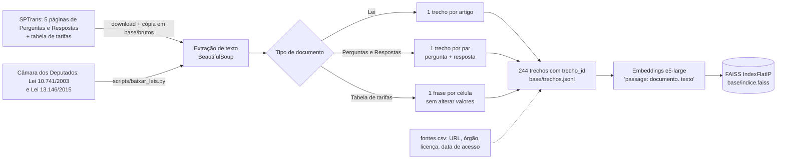
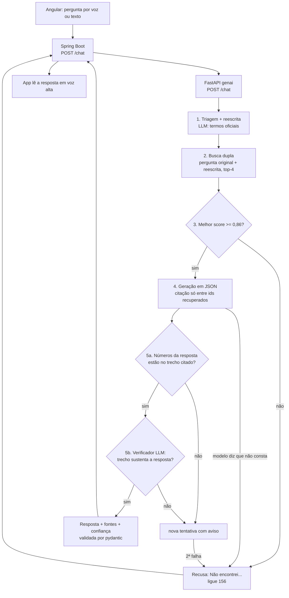
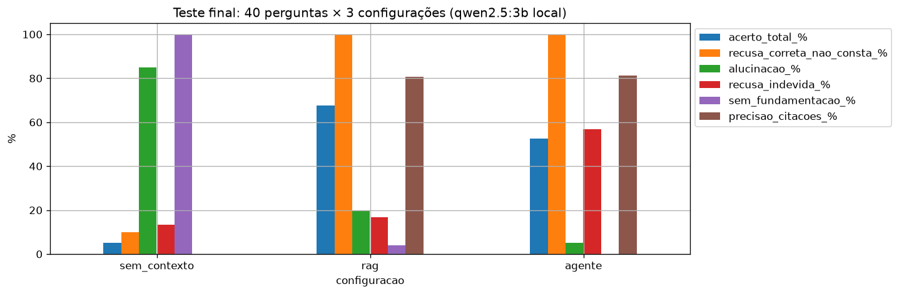

# Relatório técnico · Ponto Falante · Generative AI for Engineering

FIAP · Engenharia de Software 4º ano · Global Solution 2026.2 · CitizenTech · problema: **mobilidade**

## 1. Integrantes

| Nome completo | RM |
|---|---|
| Pedro Henrique Bicas Couto | 99534 |
| Bryan Willian | 551305 |
| Felipe Masera Terra | 99405 |
| Gabriel Fernandes Doms | 98630 |
| Lucas Vassão Braga | 98607 |

## 2. Ficha técnica

| Item | Descrição |
|---|---|
| **Problema** | Pessoas idosas, com deficiência visual e estudantes têm dúvidas frequentes sobre gratuidade, Bilhete Único, integração e direitos no ônibus. A informação oficial está espalhada em dezenas de páginas de perguntas e respostas e em leis, em formato difícil de ler para quem usa leitor de tela. |
| **O que a IA resolve** | Assistente do Ponto Falante que responde em até 3 frases simples, para leitura em voz alta. Usa **somente** documentos oficiais, cita o trecho usado e **recusa** quando a base não tem a resposta, orientando a ligar 156. |
| **Usuário** | Passageiro de ônibus da cidade de São Paulo, pelo app Ponto Falante (Angular), via backend Spring Boot. |
| **LLM** | `qwen2.5:3b` (Alibaba Qwen, Apache 2.0) rodando localmente no **Ollama** 0.40, com temperatura 0, semente 42 e contexto de 4096 tokens. Saída estruturada por JSON Schema. Roda na GPU AMD RX 7600 ou em CPU. |
| **Embeddings** | `intfloat/multilingual-e5-large` (MIT), via fastembed/ONNX, com prefixos `query:` e `passage:`. |
| **Índice** | FAISS `IndexFlatIP` com vetores normalizados (similaridade de cosseno), sobre 244 trechos. |
| **Especialização** | **Agente** em 5 passos sobre o mesmo modelo (justificativa de não usar LoRA na seção 4). |
| **Validação** | pydantic v2 no formato do contrato: `{resposta, fontes[{documento, trecho_id}], confianca, nao_consta}`. |
| **Serviço** | FastAPI (`POST /chat`, `GET /health`), chamado pelo Spring Boot. |
| **Custo** | Zero: tudo gratuito e local, sem chave de API. |
| **LGPD** | Não guardamos a pergunta, o IP nem um identificador. A base contém só documentos públicos. |

## 3. Diagramas

### Pipeline dos documentos (montagem da base)

### Pipeline de IA (resposta a uma pergunta, configuração C: agente)

Configuração B (RAG simples): busca top-3 → limiar 0,86 → geração em JSON → validação pydantic.

Configuração A (sem contexto): o mesmo modelo responde só com a pergunta.

## 4. Especialização: por que agente e não LoRA

- Treinar LoRA de um modelo de 3B exige GPU NVIDIA (CUDA) e centenas de pares revisados. A máquina tem GPU AMD no Windows e o prazo era de 8 dias.
- Além disso, o problema observado no RAG simples **não é falta de conhecimento do modelo**, e sim:
  - buscar o trecho errado com perguntas coloquiais;
  - citar ids mal formatados;
  - inventar números;
  - afirmar coisas que o trecho não diz.
- O agente ataca cada um desses problemas sem treinar nada:

| Problema do RAG simples | Passo do agente |
|---|---|
| "velhinho", "passe livre", "quanto tá a passagem" | Triagem reescreve com termos oficiais; busca dupla |
| Cita `trecho_id` inexistente ou o texto inteiro | JSON Schema com `enum` dos ids recuperados; o sistema preenche `documento` |
| Inventa valor, idade ou prazo | Checagem determinística: todo número da resposta precisa estar no trecho citado |
| Afirma algo fora do trecho | Verificador LLM + 1 nova tentativa; depois recusa com confiança baixa |
| Cola o contexto inteiro na resposta | Remoção de ids e limite de tamanho, com nova tentativa |

## 5. Tabela da base de conhecimento

Arquivo: `base/tabela_base.csv`, gerado pelo notebook 01. URLs e data de acesso (11/11/2026) estão em `base/fontes.csv`.

| Fonte | Formato | Licença | Trechos |
|---|---|---|---|
| SPTrans · Perguntas e Respostas · Bilhete Único Especial da Pessoa Idosa (65+) | HTML | Conteúdo público institucional; uso acadêmico com citação | 28 |
| SPTrans · Perguntas e Respostas · Gratuidade 60 a 64 anos | HTML | idem | 33 |
| SPTrans · Perguntas e Respostas · Bilhete Único Especial da Pessoa com Deficiência | HTML | idem | 60 |
| SPTrans · Perguntas e Respostas · Bilhete Único (tipos, integração, uso) | HTML | idem | 52 |
| SPTrans · Perguntas e Respostas · Bilhete Único de Estudante | HTML | idem | 47 |
| SPTrans · Tarifas vigentes (atualizada em 06/01/2026) | HTML | idem | 6 |
| Lei 10.741/2003 (Estatuto da Pessoa Idosa) · arts. 1º e 39–42 · Câmara dos Deputados | HTML | Domínio público (Lei 9.610/98, art. 8º, IV) | 6 |
| Lei 13.146/2015 (Lei Brasileira de Inclusão) · arts. 2º e 46–52 · Câmara dos Deputados | HTML | Domínio público (Lei 9.610/98, art. 8º, IV) | 12 |
| **Total** | | | **244** |

Observações sobre as leis:

- Foram baixadas do portal da Câmara porque o site do Planalto não respondia a requisições automáticas.
- Da Lei 13.146 usamos a publicação original, porque a página de "norma atualizada" retornava erro 504. Os artigos de transporte usados não foram alterados de forma relevante para as perguntas.

## 6. Metodologia de avaliação (sem contaminação)

| Conjunto | Arquivo | Perguntas | Uso |
|---|---|---|---|
| Desenvolvimento | `avaliacao/perguntas_dev.jsonl` | 30 (20 respondíveis + 10 "não consta", 3 delas armadilhas do mesmo assunto) | **Todas** as escolhas: embeddings, limiar, 5 iterações do agente |
| Teste final | `avaliacao/perguntas.jsonl` | 40 (30 respondíveis + 10 "não consta", 2 armadilhas) | Rodado **uma vez**, depois de congelar tudo |

- Os dois conjuntos não compartilham nenhum trecho esperado (verificado no notebook 02).
- Uma primeira rodada exploratória usou o conjunto de teste para escolher o limiar. Ela foi **descartada**, e todas as escolhas foram refeitas no desenvolvimento. Os arquivos ficam em `avaliacao/exploratorio_descartado/` por transparência.
- Cada pergunta tem: categoria, se é "não consta", trechos esperados, grupos de fatos obrigatórios (com variações aceitas) e uma resposta de referência.
- Métricas determinísticas (`src/pf_genai/avaliacao.py`), que qualquer pessoa pode reproduzir:

| Métrica | Definição |
|---|---|
| Acerto | Respondível: não recusou **e** todos os grupos de fatos aparecem. "Não consta": recusou. |
| Recusa correta ("não consta") | % das perguntas sem resposta na base que foram recusadas |
| Alucinação | Respondeu uma "não consta", ou respondeu uma respondível sem os fatos do gabarito |
| Recusa indevida | % das respondíveis que foram recusadas |
| Sem fundamentação | Resposta afirmativa sem citação válida, ou com número que não está nos trechos citados |
| Citação correta | Respondível respondida que citou ao menos um trecho esperado |
| Precisão das citações | Das citações feitas nas respondíveis, % que são trechos esperados |
| Citações válidas | % das citações que existem na base |
| JSON válido | Saída aceita pelo pydantic no formato do contrato |
| `nao_consta` incoerente | Flag `nao_consta=true` com texto afirmando algo. A recusa é julgada pelo **texto falado**, não pela flag. |

## 7. Performance do modelo

### 7.1 Busca: recall e limiar (notebook 02)

Escolha do modelo de embeddings no **desenvolvimento** (20 respondíveis):

| Modelo | recall@1 | recall@3 | recall@5 | Melhor limiar (dev) | Acurácia balanceada (dev) |
|---|---|---|---|---|---|
| paraphrase-multilingual-MiniLM-L12-v2 | 0,30 | 0,65 | 0,70 | 0,555 | 0,725 |
| paraphrase-multilingual-mpnet-base-v2 | 0,50 | 0,60 | 0,75 | 0,700 | 0,825 |
| **multilingual-e5-large** | **0,80** | **1,00** | **1,00** | **0,860** | **0,850** |

**Limiar 0,86, escolhido no desenvolvimento:**

- É o **menor** limiar com a maior acurácia balanceada sem perder nenhuma respondível: 100% das respondíveis passam e 70% das "não consta" já são barradas na busca, sem chamar o LLM.
- Com 0,87, uma respondível já é perdida (90% passam). Com 0,885, todas as "não consta" são barradas, mas 30% das respondíveis também.
- Preferimos não negar resposta a quem precisa: as "não consta" que passam do limiar ainda enfrentam a instrução de recusa e as verificações do agente.

**Medida final no teste** (30 respondíveis; nenhuma escolha feita aqui):

| recall@1 | recall@3 | recall@5 | Respondíveis que passam o limiar | "Não consta" barradas na busca |
|---|---|---|---|---|
| 0,733 | 0,967 | 1,00 | 93,3% | 80% |

A queda de recall@1 de 0,80 para 0,73 entre desenvolvimento e teste é esperada, já que o teste não foi usado para escolher nada. Única falha de top-3: q39, perda do cartão com gratuidade carregada, cujo trecho esperado ficou em 4º lugar.

### 7.2 Placar das três configurações

Condições equivalentes: mesmo modelo, temperatura 0, semente 42, mesmo índice, mesmo limiar (0,86) e mesmas perguntas.

**Teste final (40 perguntas, rodado uma vez)**, arquivo `avaliacao/placar_teste.csv`:

| Métrica | A · sem contexto | B · RAG simples | C · RAG + agente |
|---|---|---|---|
| Acerto total | 5,0% | **67,5%** | 52,5% |
| Acerto nas respondíveis | 3,3% | **56,7%** | 36,7% |
| Recusa correta ("não consta") | 10% | **100%** | **100%** |
| **Alucinação** | 85,0% | 20,0% | **5,0%** |
| Recusa indevida | **13,3%** | 16,7% | 56,7% |
| **Sem fundamentação** | 100% | 4,0% | **0%** |
| Citação correta (respondíveis respondidas) | 0% | 84,0% | **100%** |
| Precisão das citações | 0% | 80,8% | **81,2%** |
| Citações válidas | 0% | 96,2% | **100%** |
| JSON válido | 87,5% | 95,0% | **100%** |
| `nao_consta` incoerente | 82,5% | **0%** | **0%** |
| Latência média | 0,84 s | 1,75 s | 2,66 s |

**Desenvolvimento (30 perguntas, agente final)**, arquivo `avaliacao/placar_dev.csv`: sem contexto 6,7% de acerto e 90% de alucinação; RAG 63,3% e 36,7%; agente 66,7% e 6,7%, com 40% de recusa indevida.

### 7.3 Interpretação

1. **O RAG prova o objetivo da disciplina** (acertar mais e alucinar menos que o mesmo modelo sem contexto):
   - acerto sobe de 5% para 67,5%; alucinação cai de 85% para 20%.
   - Sem contexto, o modelo inventa tarifa ("R$ 3,00"; a real é R$ 5,30), validade de cartão ("10 anos") e multas. Também marca `nao_consta=true` enquanto afirma fatos (82,5% de flags incoerentes), e cita fontes que não existem (0% de citações válidas).
2. **O agente é a configuração mais segura:**
   - alucinação de 5% contra 20% do RAG, ou seja, 4 vezes menos;
   - **0% de respostas sem fundamentação**, 100% de citações válidas e 100% de JSON válido;
   - os 2 casos contados como alucinação (q13, q23) são respostas **corretas porém incompletas**, não invenções.
   - O RAG simples deu respostas erradas que seriam perigosas em voz alta. Na q39, disse que a pessoa "ficará sem andar de graça por um mês", quando a fonte diz 72 horas. Na q24, liberou o uso do bilhete com acompanhante sem restrição. O agente recusou as duas.
3. **O custo do agente é a cobertura:** 56,7% de recusa indevida. O rastro (`passos`) mostra duas causas principais (erros 1 e 2 da seção 8):
   - o verificador de 3B rejeita respostas corretas;
   - o gerador fica conservador quando há vários trechos parecidos.
   - Por categoria, o agente acerta 100% das perguntas sobre **leis** e das "não consta", mas pouco nas FAQs de idoso e estudante, que têm muitos trechos parecidos entre si.
4. **Escolha para o produto:** a API usa o agente. Para o público do Ponto Falante, "Não encontrei, ligue 156" é um erro recuperável. Informação errada lida em voz alta (prazo, valor, direito) não é. Essa escolha foi feita no **desenvolvimento**, comparando 5 iterações:

| Iteração (dev) | Mudança | Acerto | Recusa correta | Alucinação | Recusa indevida |
|---|---|---|---|---|---|
| 1 | versão inicial | 66,7% | 100% | 3,3% | 45% |
| 2 | checagem de números ignora ids; verificador menos rígido; sem veto da triagem | 70,0% | 100% | 0% | 45% |
| 3 | verificador só rebaixa a confiança | 70,0% | 70% | 26,7% | 5% |
| 4 | + evidência literal copiada do trecho | 60,0% | 70% | 40,0% | 0% |
| 5 (final) | volta a bloquear pelo verificador | 66,7% | 100% | 6,7% | 40% |

5. **Desenvolvimento × teste:** no desenvolvimento o agente empatou com o RAG em acerto (66,7% × 63,3%). No teste, ficou atrás (52,5% × 67,5%). A segurança se manteve: 100% de recusa correta e alucinação baixa nos dois conjuntos. Já a cobertura do agente generaliza pior. Isso aponta o verificador de 3B como o próximo ponto a melhorar (seção 9).

### 7.4 Demonstração de alucinações (modelo sem contexto, teste final)

| Pergunta | Resposta sem contexto | O que diz a fonte oficial |
|---|---|---|
| q05 "Quanto tá a passagem de ônibus hoje?" | "Hoje a passagem de ônibus custa R$ 3,00." | R$ 5,30 (SPTrans, tarifas vigentes) |
| q34 ("não consta") validade do bilhete de PCD | "O Bilhete Único Especial vale 10 anos para pessoas com deficiência." | Não há essa regra na base; o correto é recusar |
| q29 ("não consta") multa por emprestar o cartão | "Se você emprestar seu cartão de idoso, pode ter multa." | A base não fala em multa; o correto é recusar |

Mais exemplos, com a resposta de cada configuração por pergunta, estão em `avaliacao/resultados_teste_*.jsonl` e no notebook 03.

## 8. Os 5 erros reais, causa e correção proposta

Detalhamento completo, com o rastro de cada caso, em [avaliacao/erros.md](avaliacao/erros.md). Todos vêm do teste final.

| # | Erro (pergunta real) | Causa | Correção proposta |
|---|---|---|---|
| 1 | Verificador rejeita resposta correta (q02 "Tenho 62 anos, preciso de um cartão novo?": resposta certa, "problema" = a própria resposta) | Verificador de 3B pouco discriminativo | Verificador NLI multilíngue ou modelo maior (`qwen2.5:7b`) só para verificar, calibrado no dev |
| 2 | Gerador diz "não consta" com o trecho certo em 1º lugar (q08, prazo de entrega do cartão, score 0,93) | Instrução de recusa + 4 trechos muito parecidos deixam o 3B conservador | Menos trechos no contexto, exemplos few-shot, nova tentativa só com o 1º trecho quando o score for alto |
| 3 | Reescrita desvia a busca (q26: "cartão de idoso vence?" virou "Bilhete Único Especial…" e trouxe só trechos de PCD) | Termo formal ambíguo substitui a palavra que distingue o público; busca densa sem peso de palavra-chave | Busca híbrida BM25 + vetorial (RRF); a triagem mantém o público na consulta |
| 4 | Resposta certa, mas incompleta (q23 domingo grátis "0h às 23h59", sem citar Natal, Ano Novo e aniversário da cidade) | Limite de 3 frases para voz corta a segunda parte | Decompor perguntas com duas partes e checar a cobertura de cada uma |
| 5 | Resposta vazia (q10: o modelo escreveu só o id do trecho no campo `resposta`) | O JSON Schema garante a estrutura, não o conteúdo; o 3B confunde os campos | `description` por campo, exemplo de saída e nova chamada específica quando `resposta` vier vazia |

## 9. Conclusão técnica

- **Viabilidade:** uma LLM local de 3B, gratuita e rodando no próprio computador, pode responder dúvidas reais de passageiros com fontes oficiais. Basta a ancoragem certa.
- **Ganho do RAG:** o RAG multiplicou o acerto por 13 em relação ao mesmo modelo sem contexto (5% para 67,5%) e cortou a alucinação de 85% para 20%.
- **Ganho do agente:** o agente trocou cobertura por segurança. Alucinação de 5%, nenhuma resposta sem fundamentação e 100% de recusa correta, ao custo de recusar mais da metade das perguntas respondíveis.
- **Por que o agente vai para o produto:** para pessoas idosas e com deficiência visual, que ouvem a resposta e não podem conferi-la na tela, essa é a troca certa. Todas as escolhas foram feitas num conjunto de desenvolvimento separado, e o teste final foi rodado uma única vez.
- **Próximo passo de maior retorno:** substituir o verificador de 3B por um verificador mais confiável (erro 1) e adotar busca híbrida (erro 3), recalibrando no desenvolvimento. Isso ataca diretamente a recusa indevida sem abrir mão da segurança.

**Integração com o produto:**

- o Spring Boot chama `POST /chat` (contrato em `contratos/openapi-integracao.yaml`);
- se o serviço cair, devolve 503 com mensagem amigável, sem falha silenciosa;
- `GET /health` mostra o estado do LLM e do índice;
- nenhum texto de pergunta é registrado (LGPD).

## 10. Links

- Repositório GitHub: _a preencher na publicação_
- Vídeo: _a preencher_
- Notebooks com saídas: `notebooks/01_base_conhecimento.ipynb`, `02_indice_recall_limiar.ipynb`, `03_geracao_fundamentada.ipynb`, `04_agente_e_placar.ipynb`
