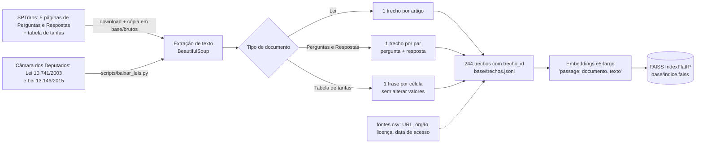
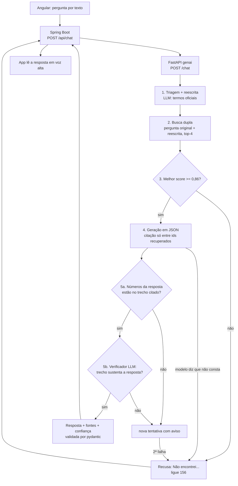
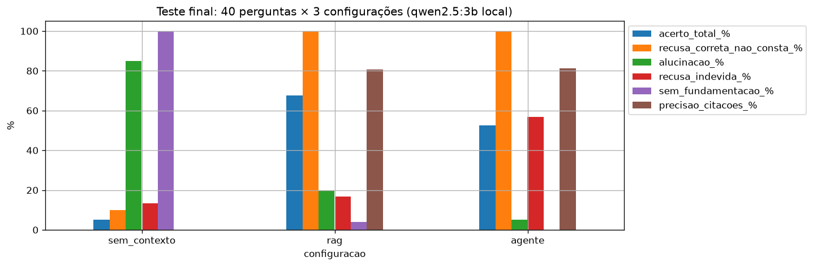

# Registro técnico detalhado · GenAI

> Documento interno da equipe. Guarda, sem cortes, o histórico das iterações, das correções e da operação que
> antes ficava no relatório. O relatório acadêmico entregue aos professores é [../RELATORIO.md](../RELATORIO.md).

## Relatório técnico (versão de 15/11/2026, preservada)

FIAP · Engenharia de Software 4º ano · Global Solution 2026.2 · CitizenTech · problema: **mobilidade**

**Versão de entrega, 14/11/2026.** As seções 6 a 9 preservam o ciclo original com o modelo 3B.
As seções 11 a 13 registram as iterações posteriores; o produto e o vídeo usam o agente com
`qwen2.5:7b`. Os placares permanecem congelados. Vídeo e roteiro estão concluídos localmente;
faltam as URLs de hospedagem do vídeo e do repositório público sanitizado.

## 1. Integrantes

| Nome completo | RM |
|---|---|
| Pedro Henrique Bicas Couto | 99534 |
| Bryan Willian | 551305 |
| Felipe Masera Terra | 99405 |
| Gabriel Fernandes Doms | 98630 |
| Lucas Vassão Braga | 98607 |

## 2. Ficha técnica

| Item | Descrição |
|---|---|
| **Problema** | Pessoas idosas, com deficiência visual e estudantes têm dúvidas frequentes sobre gratuidade, Bilhete Único, integração e direitos no ônibus. A informação oficial está espalhada em dezenas de páginas de perguntas e respostas e em leis, em formato difícil de ler para quem usa leitor de tela. |
| **O que a IA resolve** | Assistente do Ponto Falante que responde em até 3 frases simples, para leitura em voz alta. Usa **somente** documentos oficiais, cita o trecho usado e **recusa** quando a base não tem a resposta, orientando a ligar 156. |
| **Usuário** | Passageiro de ônibus da cidade de São Paulo, pelo app Ponto Falante (Angular), via backend Spring Boot. |
| **LLM** | Produto atual: `qwen2.5:7b` com agente; ciclo original: `qwen2.5:3b` (Alibaba Qwen, Apache 2.0). Execução local no **Ollama**, temperatura 0, semente 42 e contexto de 4096 tokens. Saída estruturada por JSON Schema. Máquina com GPU AMD RX 7600; não foi medida a distribuição CPU/GPU durante o vídeo. |
| **Embeddings** | `intfloat/multilingual-e5-large` (MIT), via fastembed/ONNX, com prefixos `query:` e `passage:`. |
| **Índice** | FAISS `IndexFlatIP` com vetores normalizados (similaridade de cosseno), sobre 244 trechos. |
| **Especialização** | **Agente** em 5 passos sobre o mesmo modelo (justificativa de não usar LoRA na seção 4). |
| **Validação** | pydantic v2 no formato do contrato: `{resposta, fontes[{documento, trecho_id}], confianca, nao_consta}`. |
| **Serviço** | FastAPI (`POST /chat`, `GET /health`), chamado pelo Spring Boot. |
| **Custo** | Modelo local, sem cobrança por token. A API do produto exige chave de autenticação em variável de ambiente; ela não aparece no repositório nem no vídeo. |
| **LGPD** | A API não persiste perguntas, IPs ou identificadores. A limitação de chamadas usa identificadores temporários em memória. O navegador mantém o histórico da conversa. A base contém documentos públicos. |

## 3. Diagramas

### Pipeline dos documentos (montagem da base)

### Pipeline de IA (resposta a uma pergunta, configuração C: agente)

Configuração B (RAG simples): busca top-3 → limiar 0,86 → geração em JSON → validação pydantic.

Configuração A (sem contexto): o mesmo modelo responde só com a pergunta.

## 4. Especialização: por que agente e não LoRA

- Treinar LoRA de um modelo de 3B exige GPU NVIDIA (CUDA) e centenas de pares revisados. A máquina tem GPU AMD no Windows e o prazo era de 8 dias.
- Além disso, o problema observado no RAG simples **não é falta de conhecimento do modelo**, e sim:
  - buscar o trecho errado com perguntas coloquiais;
  - citar ids mal formatados;
  - inventar números;
  - afirmar coisas que o trecho não diz.
- O agente ataca cada um desses problemas sem treinar nada:

| Problema do RAG simples | Passo do agente |
|---|---|
| "velhinho", "passe livre", "quanto tá a passagem" | Triagem reescreve com termos oficiais; busca dupla |
| Cita `trecho_id` inexistente ou o texto inteiro | JSON Schema com `enum` dos ids recuperados; o sistema preenche `documento` |
| Inventa valor, idade ou prazo | Checagem determinística: todo número da resposta precisa estar no trecho citado |
| Afirma algo fora do trecho | Verificador LLM + 1 nova tentativa; depois recusa com confiança baixa |
| Cola o contexto inteiro na resposta | Remoção de ids e limite de tamanho, com nova tentativa |

## 5. Tabela da base de conhecimento

Arquivo: `base/tabela_base.csv`, gerado pelo notebook 01. URLs e data de acesso (11/11/2026) estão em `base/fontes.csv`.

| Fonte | Formato | Licença | Trechos |
|---|---|---|---|
| SPTrans · Perguntas e Respostas · Bilhete Único Especial da Pessoa Idosa (65+) | HTML | Conteúdo público institucional; uso acadêmico com citação | 28 |
| SPTrans · Perguntas e Respostas · Gratuidade 60 a 64 anos | HTML | idem | 33 |
| SPTrans · Perguntas e Respostas · Bilhete Único Especial da Pessoa com Deficiência | HTML | idem | 60 |
| SPTrans · Perguntas e Respostas · Bilhete Único (tipos, integração, uso) | HTML | idem | 52 |
| SPTrans · Perguntas e Respostas · Bilhete Único de Estudante | HTML | idem | 47 |
| SPTrans · Tarifas vigentes (atualizada em 06/01/2026) | HTML | idem | 6 |
| Lei 10.741/2003 (Estatuto da Pessoa Idosa) · arts. 1º e 39–42 · Câmara dos Deputados | HTML | Domínio público (Lei 9.610/98, art. 8º, IV) | 6 |
| Lei 13.146/2015 (Lei Brasileira de Inclusão) · arts. 2º e 46–52 · Câmara dos Deputados | HTML | Domínio público (Lei 9.610/98, art. 8º, IV) | 12 |
| **Total** | | | **244** |

Observações sobre as leis:

- Foram baixadas do portal da Câmara porque o site do Planalto não respondia a requisições automáticas.
- Da Lei 13.146 usamos a publicação original, porque a página de "norma atualizada" retornava erro 504. Os artigos de transporte usados não foram alterados de forma relevante para as perguntas.

## 6. Metodologia de avaliação (sem contaminação)

| Conjunto | Arquivo | Perguntas | Uso |
|---|---|---|---|
| Desenvolvimento | `avaliacao/perguntas_dev.jsonl` | 30 (20 respondíveis + 10 "não consta", 3 delas armadilhas do mesmo assunto) | **Todas** as escolhas: embeddings, limiar, 5 iterações do agente |
| Teste final | `avaliacao/perguntas.jsonl` | 40 (30 respondíveis + 10 "não consta", 2 armadilhas) | Rodado **uma vez**, depois de congelar tudo |

- Os dois conjuntos não compartilham nenhum trecho esperado (verificado no notebook 02).
- Uma primeira rodada exploratória usou o conjunto de teste para escolher o limiar. Ela foi **descartada**, e todas as escolhas foram refeitas no desenvolvimento. Os arquivos ficam em `avaliacao/exploratorio_descartado/` por transparência.
- Cada pergunta tem: categoria, se é "não consta", trechos esperados, grupos de fatos obrigatórios (com variações aceitas) e uma resposta de referência.
- Métricas determinísticas (`src/pf_genai/avaliacao.py`), que qualquer pessoa pode reproduzir:

| Métrica | Definição |
|---|---|
| Acerto | Respondível: não recusou **e** todos os grupos de fatos aparecem. "Não consta": recusou. |
| Recusa correta ("não consta") | % das perguntas sem resposta na base que foram recusadas |
| Alucinação | Respondeu uma "não consta", ou respondeu uma respondível sem os fatos do gabarito |
| Recusa indevida | % das respondíveis que foram recusadas |
| Sem fundamentação | Resposta afirmativa sem citação válida, ou com número que não está nos trechos citados |
| Citação correta | Respondível respondida que citou ao menos um trecho esperado |
| Precisão das citações | Das citações feitas nas respondíveis, % que são trechos esperados |
| Citações válidas | % das citações que existem na base |
| JSON válido | Saída aceita pelo pydantic no formato do contrato |
| `nao_consta` incoerente | Flag `nao_consta=true` com texto afirmando algo. A recusa é julgada pelo **texto falado**, não pela flag. |

## 7. Performance do modelo

### 7.1 Busca: recall e limiar (notebook 02)

Escolha do modelo de embeddings no **desenvolvimento** (20 respondíveis):

| Modelo | recall@1 | recall@3 | recall@5 | Melhor limiar (dev) | Acurácia balanceada (dev) |
|---|---|---|---|---|---|
| paraphrase-multilingual-MiniLM-L12-v2 | 0,30 | 0,65 | 0,70 | 0,555 | 0,725 |
| paraphrase-multilingual-mpnet-base-v2 | 0,50 | 0,60 | 0,75 | 0,700 | 0,825 |
| **multilingual-e5-large** | **0,80** | **1,00** | **1,00** | **0,860** | **0,850** |

**Limiar 0,86, escolhido no desenvolvimento:**

- É o **menor** limiar com a maior acurácia balanceada sem perder nenhuma respondível: 100% das respondíveis passam e 70% das "não consta" já são barradas na busca, sem chamar o LLM.
- Com 0,87, uma respondível já é perdida (90% passam). Com 0,885, todas as "não consta" são barradas, mas 30% das respondíveis também.
- Preferimos não negar resposta a quem precisa: as "não consta" que passam do limiar ainda enfrentam a instrução de recusa e as verificações do agente.

**Medida final no teste** (30 respondíveis; nenhuma escolha feita aqui):

| recall@1 | recall@3 | recall@5 | Respondíveis que passam o limiar | "Não consta" barradas na busca |
|---|---|---|---|---|
| 0,733 | 0,967 | 1,00 | 93,3% | 80% |

A queda de recall@1 de 0,80 para 0,73 entre desenvolvimento e teste é esperada, já que o teste não foi usado para escolher nada. Única falha de top-3: q39, perda do cartão com gratuidade carregada, cujo trecho esperado ficou em 4º lugar.

### 7.2 Placar das três configurações

Condições equivalentes: mesmo modelo, temperatura 0, semente 42, mesmo índice, mesmo limiar (0,86) e mesmas perguntas.

**Teste final (40 perguntas, rodado uma vez)**, arquivo `avaliacao/placar_teste.csv`:

| Métrica | A · sem contexto | B · RAG simples | C · RAG + agente |
|---|---|---|---|
| Acerto total | 5,0% | **67,5%** | 52,5% |
| Acerto nas respondíveis | 3,3% | **56,7%** | 36,7% |
| Recusa correta ("não consta") | 10% | **100%** | **100%** |
| **Alucinação** | 85,0% | 20,0% | **5,0%** |
| Recusa indevida | **13,3%** | 16,7% | 56,7% |
| **Sem fundamentação** | 100% | 4,0% | **0%** |
| Citação correta (respondíveis respondidas) | 0% | 84,0% | **100%** |
| Precisão das citações | 0% | 80,8% | **81,2%** |
| Citações válidas | 0% | 96,2% | **100%** |
| JSON válido | 87,5% | 95,0% | **100%** |
| `nao_consta` incoerente | 82,5% | **0%** | **0%** |
| Latência média | 0,84 s | 1,75 s | 2,66 s |

**Desenvolvimento (30 perguntas, agente final)**, arquivo `avaliacao/placar_dev.csv`: sem contexto 6,7% de acerto e 90% de alucinação; RAG 63,3% e 36,7%; agente 66,7% e 6,7%, com 40% de recusa indevida.

### 7.3 Interpretação

1. **O RAG prova o objetivo da disciplina** (acertar mais e alucinar menos que o mesmo modelo sem contexto):
   - acerto sobe de 5% para 67,5%; alucinação cai de 85% para 20%.
   - Sem contexto, o modelo inventa tarifa ("R$ 3,00"; a real é R$ 5,30), validade de cartão ("10 anos") e multas. Também marca `nao_consta=true` enquanto afirma fatos (82,5% de flags incoerentes), e cita fontes que não existem (0% de citações válidas).
2. **O agente é a configuração mais segura:**
   - alucinação de 5% contra 20% do RAG, ou seja, 4 vezes menos;
   - **0% de respostas sem fundamentação**, 100% de citações válidas e 100% de JSON válido;
   - os 2 casos contados como alucinação (q13, q23) são respostas **corretas porém incompletas**, não invenções.
   - O RAG simples deu respostas erradas que seriam perigosas em voz alta. Na q39, disse que a pessoa "ficará sem andar de graça por um mês", quando a fonte diz 72 horas. Na q24, liberou o uso do bilhete com acompanhante sem restrição. O agente recusou as duas.
3. **O custo do agente é a cobertura:** 56,7% de recusa indevida. O rastro (`passos`) mostra duas causas principais (erros 1 e 2 da seção 8):
   - o verificador de 3B rejeita respostas corretas;
   - o gerador fica conservador quando há vários trechos parecidos.
   - Por categoria, o agente acerta 100% das perguntas sobre **leis** e das "não consta", mas pouco nas FAQs de idoso e estudante, que têm muitos trechos parecidos entre si.
4. **Escolha para o produto:** a API usa o agente. Para o público do Ponto Falante, "Não encontrei, ligue 156" é um erro recuperável. Informação errada lida em voz alta (prazo, valor, direito) não é. Essa escolha foi feita no **desenvolvimento**, comparando 5 iterações:

| Iteração (dev) | Mudança | Acerto | Recusa correta | Alucinação | Recusa indevida |
|---|---|---|---|---|---|
| 1 | versão inicial | 66,7% | 100% | 3,3% | 45% |
| 2 | checagem de números ignora ids; verificador menos rígido; sem veto da triagem | 70,0% | 100% | 0% | 45% |
| 3 | verificador só rebaixa a confiança | 70,0% | 70% | 26,7% | 5% |
| 4 | + evidência literal copiada do trecho | 60,0% | 70% | 40,0% | 0% |
| 5 (final) | volta a bloquear pelo verificador | 66,7% | 100% | 6,7% | 40% |

5. **Desenvolvimento × teste:** no desenvolvimento o agente empatou com o RAG em acerto (66,7% × 63,3%). No teste, ficou atrás (52,5% × 67,5%). A segurança se manteve: 100% de recusa correta e alucinação baixa nos dois conjuntos. Já a cobertura do agente generaliza pior. Isso aponta o verificador de 3B como o próximo ponto a melhorar (seção 9).

### 7.4 Demonstração de alucinações (modelo sem contexto, teste final)

| Pergunta | Resposta sem contexto | O que diz a fonte oficial |
|---|---|---|
| q05 "Quanto tá a passagem de ônibus hoje?" | "Hoje a passagem de ônibus custa R$ 3,00." | R$ 5,30 (SPTrans, tarifas vigentes) |
| q34 ("não consta") validade do bilhete de PCD | "O Bilhete Único Especial vale 10 anos para pessoas com deficiência." | Não há essa regra na base; o correto é recusar |
| q29 ("não consta") multa por emprestar o cartão | "Se você emprestar seu cartão de idoso, pode ter multa." | A base não fala em multa; o correto é recusar |

Mais exemplos, com a resposta de cada configuração por pergunta, estão em `avaliacao/resultados_teste_*.jsonl` e no notebook 03.

## 8. Os 5 erros reais, causa e correção proposta

Detalhamento completo, com o rastro de cada caso, em [avaliacao/erros.md](../avaliacao/erros.md). Todos vêm do teste final.

| # | Erro (pergunta real) | Causa | Correção proposta |
|---|---|---|---|
| 1 | Verificador rejeita resposta correta (q02 "Tenho 62 anos, preciso de um cartão novo?": resposta certa, "problema" = a própria resposta) | Verificador de 3B pouco discriminativo | Verificador NLI multilíngue ou modelo maior (`qwen2.5:7b`) só para verificar, calibrado no dev |
| 2 | Gerador diz "não consta" com o trecho certo em 1º lugar (q08, prazo de entrega do cartão, score 0,93) | Instrução de recusa + 4 trechos muito parecidos deixam o 3B conservador | Menos trechos no contexto, exemplos few-shot, nova tentativa só com o 1º trecho quando o score for alto |
| 3 | Reescrita desvia a busca (q26: "cartão de idoso vence?" virou "Bilhete Único Especial…" e trouxe só trechos de PCD) | Termo formal ambíguo substitui a palavra que distingue o público; busca densa sem peso de palavra-chave | Busca híbrida BM25 + vetorial (RRF); a triagem mantém o público na consulta |
| 4 | Resposta certa, mas incompleta (q23 domingo grátis "0h às 23h59", sem citar Natal, Ano Novo e aniversário da cidade) | Limite de 3 frases para voz corta a segunda parte | Decompor perguntas com duas partes e checar a cobertura de cada uma |
| 5 | Resposta vazia (q10: o modelo escreveu só o id do trecho no campo `resposta`) | O JSON Schema garante a estrutura, não o conteúdo; o 3B confunde os campos | `description` por campo, exemplo de saída e nova chamada específica quando `resposta` vier vazia |

## 9. Conclusão técnica

- **Viabilidade:** uma LLM local de 3B, gratuita e rodando no próprio computador, pode responder dúvidas reais de passageiros com fontes oficiais. Basta a ancoragem certa.
- **Ganho do RAG:** o RAG multiplicou o acerto por 13 em relação ao mesmo modelo sem contexto (5% para 67,5%) e cortou a alucinação de 85% para 20%.
- **Ganho do agente:** o agente trocou cobertura por segurança. Alucinação de 5%, nenhuma resposta sem fundamentação e 100% de recusa correta, ao custo de recusar mais da metade das perguntas respondíveis.
- **Por que o agente vai para o produto:** para pessoas idosas e com deficiência visual, que ouvem a resposta e não podem conferi-la na tela, essa é a troca certa. Todas as escolhas foram feitas num conjunto de desenvolvimento separado, e o teste final foi rodado uma única vez.
- **Próximo passo de maior retorno:** substituir o verificador de 3B por um verificador mais confiável (erro 1) e adotar busca híbrida (erro 3), recalibrando no desenvolvimento. Isso ataca diretamente a recusa indevida sem abrir mão da segurança.

**Integração com o produto:**

- o Spring Boot chama `POST /chat` (contrato em `contratos/openapi-integracao.yaml`);
- se o serviço cair, devolve 503 com mensagem amigável, sem falha silenciosa;
- `GET /health` mostra o estado do LLM e do índice;
- nenhum texto de pergunta é registrado (LGPD).

## 10. Evolução e preservação dos resultados

O ciclo original das seções anteriores permanece documentado com seu modelo e seus resultados.
As próximas seções registram v2, v3 e os ajustes de conversa separadamente. A demonstração final
usa a configuração atual do produto; ela não substitui nem recalcula os placares congelados.

## 11. Iteração v2 (após a revisão crítica independente)

A v1 acima foi preservada sem alteração (tag `experimento-original-genai-v1`). A v2 respondeu às críticas da revisão do
experimento v1.

**O que mudou**

- **Rubrica v2** (`src/pf_genai/avaliacao_v2.py`): fatos obrigatórios × opcionais, números com fronteira, guarda de negação, recusa julgada pelo texto falado e categorias separadas (correto, incompleto, erro factual, sem fato, recusa indevida/correta, resposta indevida, falha operacional), com denominadores explícitos.
- **Agente v2** (`src/pf_genai/agente_v2.py`): busca híbrida BM25 + FAISS com reordenação pelo cosseno da pergunta original, reescrita que preserva público e idade, checagem de público (idoso × PCD × estudante), reparo de recusa quando há evidência forte, verificador por afirmação que falha fechado e exige frase de apoio literal.
- **Modelos comparados:** qwen2.5:3b, qwen2.5:7b e qwen3:8b (think desligado), com ablações.

**Desenvolvimento** (30 perguntas, `avaliacao/v2/placar_dev.csv`; todas as escolhas foram feitas aqui):

| Configuração | Acerto | Recusa indevida | Erros factuais/pergunta | Latência média |
|---|---|---|---|---|
| rag_v1 | 80,0% | 0,0% | 10,0% | 2,1 s |
| agente_v1 | 66,7% | 40,0% | 3,3% | 2,8 s |
| v2_3b | 83,3% | 15,0% | 3,3% | 5,0 s |
| v2_3b sem verificador | 80,0% | 0,0% | 13,3% | 2,6 s |
| v2_3b busca só densa | 80,0% | 20,0% | 3,3% | 5,6 s |
| v2_3b sem reparo de recusa | 76,7% | 25,0% | 3,3% | 5,6 s |
| **v2_7b** | **93,3%** | **0,0%** | 3,3% | 11,2 s |
| v2_7b sem verificador | 86,7% | 0,0% | 6,7% | 7,5 s |
| v2_7b gerador + verificador 3b | 86,7% | 15,0% | 3,3% | 10,5 s |
| v2_qwen3_8b | 66,7% | 30,0% | 6,7% | 77,9 s |

As ablações mostram o efeito de cada peça: tirar o verificador aumenta os erros factuais, tirar a busca híbrida ou o
reparo aumenta a recusa indevida. O qwen3:8b foi o pior e o mais lento nesta máquina (RX 7600). Escolhida: **v2_7b**.

**Teste inédito** (`avaliacao/v2/perguntas_teste_v2.jsonl`, 40 perguntas escritas depois do desenvolvimento, 10 "não consta";
rodado **uma única vez**, em 11/11/2026, com as quatro configurações pré-definidas). Como a rubrica automática erra em
paráfrases e negações, as 160 respostas foram também **adjudicadas às cegas por um revisor independente** (itens embaralhados, sem o nome
da configuração, com acesso aos trechos-fonte; `adjudicacao_entrada_cega.json`, `adjudicacao_julgamento.jsonl`,
`adjudicacao_chave.json`). Os números abaixo são os da adjudicação; os automáticos estão em `placar_teste_v2.csv`.

| Configuração | Acerto | Correto (respondíveis) | Incompleto | Recusa indevida | Recusa correta "não consta" | Erros factuais/pergunta |
|---|---|---|---|---|---|---|
| rag_v1 | 47,5% | 13/30 | 7/30 | 3,3% | 6/10 | 27,5% (11/40) |
| agente_v1 | 47,5% | 9/30 | 1/30 | 66,7% | 10/10 | **0,0%** (0/40) |
| v2_3b | 42,5% | 9/30 | 2/30 | 53,3% | 8/10 | 12,5% (5/40) |
| **v2_7b** | **55,0%** | **14/30** | 6/30 | 20,0% | 8/10 | 15,0% (6/40) |

Concordância entre rubrica automática e adjudicação: 28 a 39 de 40 por configuração.

**Interpretação**

- **As metas não foram atingidas no teste inédito.** Acerto ≥ 80% e recusa indevida < 20% foram batidos no desenvolvimento (93,3% e 0%), mas no teste inédito a melhor configuração ficou em 55% e 20%. A diferença entre os dois conjuntos mostra sobreajuste ao desenvolvimento: o agente foi afinado em 30 perguntas e o teste trouxe perguntas compostas ("e no metrô?", "e se não chegar?"), em que a v2 responde só a primeira parte (6 incompletas).
- **Os erros factuais da v2_7b são reais e graves para o público-alvo:** confundir 30 com 60 minutos (metrô/trem), inverter "não inferior a 1 km", atribuir ao cartão a validade de 90 dias do formulário, exigir comprovante "em seu nome". O verificador por afirmação não pegou trocas de valor entre frases parecidas.
- **O agente v1 continua sendo o único sem erro factual (0/40)**, ao custo de recusar 2 de cada 3 perguntas respondíveis.
- **Nenhum resultado foi forçado:** o teste não foi repetido nem usado para ajuste; a rubrica não foi alterada depois de ver as respostas; as observações do revisor sobre a rubrica (5 perguntas) ficam registradas para uma próxima versão.

**Configuração do produto.** A API aceita `PF_MODO=agente` (v1, padrão, prioriza não errar), `PF_MODO=v2` (com
`PF_MODELO_GERADOR`/`PF_MODELO_VERIFICADOR=qwen2.5:7b`; responde mais e erra mais) e `PF_MODO=rag`. Para pessoas que
ouvem a resposta sem poder conferi-la, o padrão segue sendo o agente v1, com indicação do 156 em toda recusa.

**Próximos passos de maior retorno:** decompor perguntas compostas antes da busca; verificador de NLI multilíngue
(mDeBERTa) para checar valores e negações; novo conjunto de desenvolvimento com perguntas compostas; e só então um novo
teste inédito, escrito por outra pessoa.

## 12. Iteração v3 (12 e 13/11/2026)

A v2 errava em valores parecidos e respondia só metade das perguntas compostas. A v3 (`src/pf_genai/agente_v3.py`)
foi construída e afinada **só no DEV v3** (`avaliacao/v3/perguntas_dev_v3.jsonl`: 108 perguntas, 80 respondíveis e
28 que devem ser recusadas, das quais 6 de tempo real). O teste v3 (46 perguntas escritas por um autor separado, sem
acesso ao código nem ao DEV; ver `avaliacao/v3/LEIAME.md`) ficou congelado por SHA-256 até a rodada final.

**Pipeline v3**

1. Classificação de intenção (regra, tempo real, fora de escopo, injeção). Tempo real é recusado aqui: quem responde
   previsões é o backend, com a SPTrans.
2. Base reprocessada em trechos menores com o id v1 de origem (`trechos_v3.py`), para que o gabarito continue valendo.
3. Busca híbrida (BM25 + vetorial) e reordenação por cross-encoder multilíngue.
4. Limiar de recusa no score do cross-encoder e filtro de público (idoso 65+, 60-64, PCD, estudante).
5. Geração em JSON com uma citação literal por fonte usada.
6. Checagens: cada citação precisa existir no trecho, cada número da resposta precisa aparecer nas citações, e a
   resposta é cortada para voz (até 3 frases).

**Afinação no DEV (13/11).** A rodada de 12/11 mostrou que 13 das 80 respondíveis eram recusadas. Lendo cada caso:
o limiar 0,0 cortava perguntas com o trecho certo em 1º lugar (scores -0,53, -1,05 e -2,26), e a checagem "há fonte
citada sem evidência" recusava respostas corretas em que o modelo listava uma fonte a mais. Duas mudanças, medidas
uma de cada vez:

- **Poda de fonte sem evidência:** a fonte listada sem citação literal sai da resposta, e os números continuam
  auditados contra as citações que sobraram (teste `test_poda_remove_fonte_sem_evidencia_mas_audita_numeros`).
- **Limiar -2,5:** no DEV, com -2,5 só 1 respondível fica abaixo do corte; as 9 "não consta" que passam a chegar ao
  modelo continuam sendo recusadas por ele (100% de recusa correta). Abaixo disso o ganho é zero e o risco cresce.

| Configuração (DEV v3, rubrica v3.1) | Acerto | Correto (respondíveis) | Recusa indevida | Erro factual (respondíveis) | Recusa correta | Latência média |
|---|---|---|---|---|---|---|
| sem_contexto (mesmo 7B, sem base) | 19,4% | 21,2% | 1,2% | 8,8% | 14,3% | 2,5 s |
| rag_v1 (busca + 7B) | 82,4% | 80,0% | 5,0% | 3,8% | 89,3% | 2,5 s |
| v3_7b (12/11, limiar 0,0) | 81,5% | 76,2% | 16,2% | 3,8% | 96,4% | 8,5 s |
| v3_7b + poda | 83,3% | 78,8% | 13,8% | 3,8% | 96,4% | 8,8 s |
| **v3_final** (poda + limiar -2,5) | **88,0%** | **83,8%** | **6,2%** | 3,8% | **100%** | 8,0 s |

Na v3_final, 94,6% das respostas emitidas têm citação pertinente e nenhuma sai sem citação. Pastas:
`avaliacao/v3/retomada_dev_20261112/` e `avaliacao/v3/iteracao_dev_20261113/`.

**Teste final v3 (rodada única)**

Rodado **uma vez**, em 13/11/2026, com o mesmo `qwen2.5:7b` (temperatura 0, semente 42) para todas as configurações e as
configurações escolhidas antes de abrir o conjunto (`avaliacao/v3/teste_final_20261113/`; o marcador
`avaliacao/v3/teste_v3.execucao.json` impede uma segunda rodada). 46 perguntas: 33 respondíveis e 13 a recusar (5 de
tempo real). Números da rubrica automática v3.1, sem nenhuma correção manual:

| Configuração | Acerto | Correto (respondíveis) | Recusa indevida | Erro factual (respondíveis) | Recusa correta | Erros factuais por pergunta | Latência média |
|---|---|---|---|---|---|---|---|
| sem_contexto | 8,7% | 6,1% | 0,0% | 15,2% | 15,4% | 34,8% | 2,9 s |
| rag_v1 | **65,2%** | **63,6%** | 9,1% | 9,1% | 69,2% | 15,2% | 2,7 s |
| **agente_v1** | **65,2%** | 57,6% | 21,2% | **6,1%** | **84,6%** | **8,7%** | 3,8 s |
| v2_7b | 58,7% | 48,5% | 24,2% | 9,1% | 84,6% | 10,9% | 31,8 s |
| v3_7b (12/11) | 50,0% | 39,4% | 36,4% | 6,1% | 76,9% | 10,9% | 8,0 s |
| v3_final | 58,7% | 51,5% | 21,2% | 9,1% | 76,9% | 13,0% | 8,4 s |

**Interpretação**

- **A v3 não generalizou.** No DEV ela passou o RAG simples (88,0% contra 82,4%); no teste inédito ficou abaixo dele e
  do agente v1 (58,7% contra 65,2%). As mudanças de 13/11 ajudaram no sentido certo (v3_final +8,7 pontos sobre a v3 de
  12/11, recusa indevida de 36,4% para 21,2%), mas o restante do ganho do DEV era ajuste a perguntas conhecidas.
- **O contexto é o maior ganho, de longe:** o mesmo 7B sem a base acerta 8,7% e erra fatos em 34,8% das perguntas.
- **O agente v1 é a configuração mais segura:** menor taxa de erro factual (8,7% por pergunta), maior recusa correta
  (84,6%) e acerto igual ao do RAG. Para quem ouve a resposta sem poder conferir, ele segue como padrão do produto
  (`PF_MODO=agente`), agora com o `qwen2.5:7b` (`PF_MODELO`), que é o modelo medido aqui.
- **Todas as citações são verificáveis:** v3_final com 0% de resposta sem citação e 96,2% de citação pertinente.
- **A rubrica automática erra contra o sistema em alguns casos.** Lendo as falhas da v3_final depois da rodada (sem
  alterar nada): t3_02 ("Não, é totalmente gratuito") e t3_18 ("só é possível com 65 anos") estão corretas, mas a
  guarda de negação contou como erro factual, o mesmo defeito do erro 5 abaixo. O placar fica como saiu; uma
  adjudicação cega, como a da v2, é o próximo passo para medir esse viés.
- Padrões de falha no teste: recusa com o trecho certo em 1º (t3_14, t3_46), pergunta com cálculo de prazo que o
  modelo não faz ("comprei há 14 meses", t3_11) e resposta que fala do assunto sem responder (t3_07).

**5 erros reais da v3_final no DEV**

| # | Pergunta | O que aconteceu | Causa | Correção proposta |
|---|---|---|---|---|
| 1 | n48 "bloqueio temporário" ao reusar o vale-transporte no mesmo ônibus | Recusou, com o trecho certo em 1º (score 5,46, muito acima do 2º) | O 7B responde "não consta" quando a pergunta descreve um sintoma e o trecho descreve a regra | Nova tentativa só com o 1º trecho quando ele se destaca; exemplos de pergunta-sintoma no prompt |
| 2 | n41 "os créditos do Bilhete Único vencem?" | Acertou os 12 meses e acrescentou "o cartão vale até 5 anos" | O 5 está em outro trecho citado; a auditoria confere se o número existe nas citações, não se ele se refere à mesma coisa | Auditar o par número + unidade + sujeito, ou exigir que cada frase tenha a sua citação |
| 3 | n47 crédito da loja virtual pago por boleto | Respondeu 72 horas; o certo é 2 dias úteis (48 horas) | O trecho certo não foi recuperado; o 1º era de outro canal de recarga, com outro prazo | Termos de canal ("loja virtual", "boleto") com peso maior na busca; separar trechos por canal |
| 4 | n08 avisar a SPTrans do falecimento da mãe idosa | Disse que é preciso comunicar o óbito; o certo é que a SPTrans sabe pelo SISOB | O trecho do SISOB não veio entre os primeiros, e o modelo completou com senso comum | Ampliar o contexto quando os primeiros trechos não falam do assunto central; recusar em vez de deduzir |
| 5 | n06 cartão apreendido por uso de terceiro | Respondeu "fica sem o benefício por 180 dias" (correto), mas a rubrica marcou erro factual | A guarda de negação da rubrica viu "sem" perto do fato e contou como negação | Erro da rubrica, não do sistema. Registrado e **não corrigido** para não mexer na régua durante o ciclo |

O caso 5 mostra o limite da rubrica automática: o placar acima pode ter pequenos erros nos dois sentidos, e por isso
cada falha foi lida à mão antes de qualquer ajuste.

**Configuração do produto.** O site usa `PF_MODO=agente` com `PF_MODELO=qwen2.5:7b` (a configuração mais segura no
teste). `PF_MODO=v3` continua disponível, com limiar -2,5 (`PF_LIMIAR_V3`) e **sem** a poda: a revisão de código de 13/11 mostrou que a poda deixa passar afirmações sem número da fonte
podada ("a segunda via é gratuita"), e ela saiu do padrão, com teste de regressão. A v3_final do teste fica
reproduzível em `scripts/rodar_v3.py`. Validado em produção em 13/11: "Tenho 66 anos. Preciso pagar a passagem de ônibus em
São Paulo?" respondida com 3 fontes (Estatuto da Pessoa Idosa e SPTrans), e "cachorro no ônibus em Curitiba" recusada
com indicação do 156.

## 13. Assistente em conversa e reparo de recusa (13 e 14/11/2026)

**Arquitetura de ferramentas.** Perguntas de horário, ponto, linha, sentido e trajeto direto não passam pelo modelo:
o backend responde com a SPTrans em tempo real e com o cadastro oficial (GTFS), e devolve um contexto só com entidades
(ponto, linha, sentido e hash salgado do ônibus de referência) que o navegador reenvia na pergunta seguinte, sem guardar horários.
Nos exemplos públicos atuais, "Quanto falta para a 875A-10?", "e o próximo?" e
"e no sentido contrário?" funcionam por esse contexto. O modelo responde só regras, com fontes. Perguntas sobre
ocorrências usam o boletim do robô, com a natureza do dado declarada.

**Reparo de recusa indevida.** O agente recusava perguntas abertas com o trecho certo em 1º lugar ("Como funciona o
Bilhete Único?"). Com `PF_REPARO_RECUSA=1`, quando o modelo diz "não consta" e o 1º trecho passa do limiar com folga
(0,02), há uma nova tentativa só com esse trecho, que continua passando pela auditoria de números e pelo verificador.
Medido **só no DEV v3** (108 perguntas, mesmo `qwen2.5:7b`; `avaliacao/v3/dev_agente_20261114/`):

| Agente v1 (DEV v3) | Acerto | Correto (respondíveis) | Recusa indevida | Erro factual (respondíveis) | Recusa correta |
|---|---|---|---|---|---|
| sem reparo | 77,8% | 70,0% | 16,2% | 5,0% | 100% |
| com reparo | 79,6% | 72,5% | 11,2% | 5,0% | 100% |

O ganho é pequeno e vem só da queda da recusa indevida, sem aumento de erro factual. O teste fechado v3 já foi usado
uma vez e **não** foi repetido, então este ganho não tem confirmação em conjunto inédito.

**Cenários de conversa.** `avaliacao/dev_conversa_20261113.jsonl` traz 8 contratos de conversa (disponibilidade,
recusa e família da fonte), verificados com o Ollama real por `scripts/validar_dev_conversa.py`. Não são uma medida de
acurácia geral.

## 14. Links e demonstração final

- Repositório atual (privado): https://github.com/pedrobicas/ponto-falante
- URL pública do repositório sanitizado: **[PENDENTE: URL_REPOSITORIO_PUBLICO]**.
- MVP publicado: https://ponto-falante.onrender.com
- Vídeo final local: [Ponto_Falante_GenAI.mp4](../../entregaveis/Ponto_Falante_GenAI.mp4), **2min22s** (142 s), 1920 x 1080, sem áudio e sem música, preparado para narração humana.
- [Roteiro de narração](../../entregaveis/ROTEIRO_GENAI.md) e [evidências da captura](../../docs/evidencias/video_genai_20261115.md). A URL pública do vídeo ainda depende de hospedagem; o arquivo local não substitui esse link na entrega FIAP.
- URL pública do vídeo: **[PENDENTE: URL_VIDEO_GENAI]**.
- Notebooks com saídas: `notebooks/01_base_conhecimento.ipynb`, `02_indice_recall_limiar.ipynb`, `03_geracao_fundamentada.ipynb`, `04_agente_e_placar.ipynb`

### Demonstração gravada em 14 e 15/11/2026 (versão 3)

O vídeo usa captura direta do site publicado (Edge sem interface controlado pelo Playwright, quadros
de 1920 x 1080) e montagem reprodutível em `scripts/video/` (`cap_genai.js`, `compor.py`, `edl_genai.json`).
Ele mostra uma conversa contínua em produção, regravada em 15/11: rota para o Centro pelo cadastro oficial (resposta em
cerca de 1,6 s), "quanto falta" e "no sentido contrário" com previsão em tempo real da SPTrans (cerca de 1,5 s cada),
gratuidade para pessoa de 66 anos com duas fontes citadas (cerca de 7 s), leitura em voz alta, pergunta sobre outra
cidade (Curitiba) e letra grande com alto contraste, com a conversa preservada. Seguem os diagramas de arquitetura do
README e deste relatório e os placares já registrados (teste inédito v3 e reparo de recusa no DEV), apenas lidos dos CSVs.
A espera da gratuidade foi acelerada e o vídeo indica isso com um selo; os textos não foram editados.

**Correção de 15/11 que motivou a regravação.** Na versão 2, a pergunta sobre Curitiba terminava com o encaminhamento
ao 156 da SPTrans, que vale só para São Paulo, e a interface exibia a confiança gerada pelo modelo mesmo numa recusa.
Agora o backend reconhece perguntas sobre outras cidades antes de chamar a GenAI (`ForaDaArea.java`): a resposta diz que
o serviço cobre só São Paulo e orienta procurar o órgão de transporte da cidade citada, sem inventar contato. Cada
resposta também traz `tipo_resposta` (FUNDAMENTADA, CONSULTA, RECUSA, INSUFICIENTE, FORA_DA_AREA ou INDISPONIVEL), e a
tela mostra a situação correspondente em vez de uma confiança artificial. Testes: `TipoRespostaTest` (backend) e
`tipo-resposta.spec.ts` (Angular). Nada disso mudou o modelo, o limiar, o agente ou os placares registrados.

**Operação validada em 15/11.** Depois de reiniciar o serviço (`PF_KEEP_ALIVE=24h` mantém o modelo carregado), a
primeira pergunta de direitos pela produção respondeu em 7 s e as seguintes entre 8 e 10 s. Com o serviço parado, a
produção respondeu em cerca de 1 s com "O assistente está indisponível agora" (`tipo_resposta = INDISPONIVEL`). Ao
religar, o novo túnel foi registrado no backend em cerca de 1,5 min, depois de duas tentativas recusadas enquanto o
endereço do túnel propagava. Registro em `docs/evidencias/genai_operacao_20261115.md`, na raiz do projeto.

Limites registrados: com o modelo frio, a pergunta de gratuidade já excedeu o timeout de **40 s** da API em 14/11; o
diagnóstico está em `docs/evidencias/timeout_genai_20261114.md` (40.014 ms e 40.006 ms, várias chamadas ao Ollama por
pergunta). Não foi alterado modelo, limiar ou timeout. O agente v1 mantém a recusa alta medida no teste: perguntas como
"qual o valor da tarifa" podem receber "não encontrei", sempre com indicação para confirmar no 156. O vídeo é silencioso:
mostra o acionamento da Web Speech API, sem comprovar a reprodução audível em todos os aparelhos.

Nenhuma avaliação final fechada foi aberta ou reexecutada. O repositório permanece privado; hospedagem do vídeo,
cópia pública sanitizada e envio no Teams continuam pendentes.
