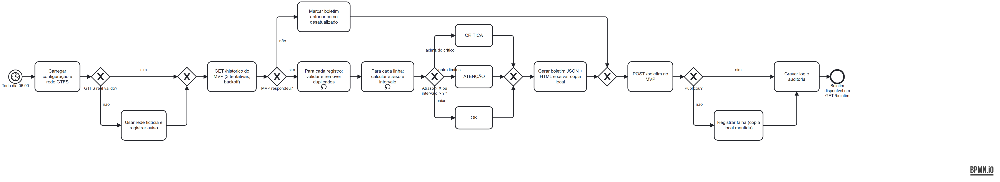

# Ponto Falante · Robô de boletim de atrasos (RPA)

**FIAP · Global Solution 2026.2 · CitizenTech · Robotic Process Automation**
Atividade: *Do Processo Manual à Automação Inteligente* · Professores: Bruno Diniz e Cibele Ribeiro

## Integrantes

| Nome completo | RM |
|---|---|
| Pedro Henrique Bicas Couto | RM 99534 |
| Bryan Willian | RM 551305 |
| Felipe Masera Terra | RM 99405 |
| Gabriel Fernandes Doms | RM 98630 |
| Lucas Vassão Braga | RM 98607 |

## O problema

O **Ponto Falante** mostra e fala a previsão dos próximos ônibus para pessoas com deficiência visual e idosos em São Paulo. Para avisar o passageiro de que uma linha anda atrasando, alguém teria de acompanhar as linhas todos os dias, anotar os atrasos, comparar com o horário programado e escrever um aviso. É um trabalho manual, repetitivo e fácil de esquecer.

**O robô faz isso sozinho, em duas partes:**

- **Coletor** (`python -m pf_rpa.coletor`, 8 vezes por dia, das 07h às 21h): consulta no MVP as previsões REAIS da SPTrans para 6 pontos de grande movimento (Paulista, Faria Lima, Nove de Julho) e grava cada consulta como amostra em `POST /api/rpa/amostras`.
- **Boletim** (`python -m pf_rpa.robo`, todo dia às 06:00): lê as amostras do dia anterior, valida e limpa, decide a situação de cada linha e publica um boletim em linguagem simples, que a tela do MVP lê em voz alta.

**Por que o boletim é ESTIMADO e não "de atrasos":** a Olho Vivo informa previsões de chegada, não chegadas observadas, e o GTFS da SPTrans descreve a maioria das linhas por frequência, sem horário de cada viagem. Uma previsão sozinha não prova atraso. O robô mede o que o dado real sustenta: a **espera prevista** em cada consulta (minutos até o próximo ônibus e intervalo entre os ônibus seguintes) e quantas vezes a linha ficou sem ônibus previsto. O boletim diz isso por escrito e na voz.

## Como funciona



Fluxo completo em [`docs/fluxo.bpmn`](docs/fluxo.bpmn) (abre em https://demo.bpmn.io).

1. **Entrada:** `config/monitoramento.yaml` (pontos coletados, limites de decisão, política de dado simulado). Nada sensível no arquivo.
2. **Coleta (coletor):** `GET /api/pontos/{codigo}/previsoes` de cada ponto. Só respostas com `fonte = OLHO_VIVO` viram amostra; dado de demonstração nunca é gravado como real. Lotes que não chegam ao MVP ficam em `saida/pendentes/` e são reenviados na execução seguinte.
3. **Leitura (boletim):** `GET /api/rpa/amostras?data=` com 3 tentativas e espera crescente (2 s, 4 s, 8 s).
4. **Validação (repetição sobre cada amostra):** campos obrigatórios, data e período, ponto dentro do escopo, previsões entre 0 e 120 min, sentidos separados (sentidos opostos não reduzem a espera). Cada inválida é guardada com o motivo.
5. **Deduplicação:** a mesma consulta (ponto e horário) conta uma vez.
6. **Decisão por linha (dado real ESTIMADO):**

| Situação | Regra (limites no YAML, seção `regras_estimadas`) |
|---|---|
| CRÍTICA | espera típica prevista > 30 min |
| ATENÇÃO | espera típica > 20 min, **ou** maior espera prevista > 30 min, **ou** sem ônibus previsto em 50% ou mais das consultas |
| OK | abaixo dos limites |
| SEM DADOS | menos de 3 consultas com previsão da linha (o robô não decide no escuro) |

   Se menos de 50% das janelas de coleta do dia foram cobertas, o boletim avisa "amostragem parcial".
7. **Sem dados suficientes para decidir:** o boletim sai como **INDISPONÍVEL**, mesmo quando houve consultas reais. Nesse caso, preserva a contagem e a classificação `VERIFICADO` da coleta, mas não afirma que a operação está normal nem inventa esperas ou atrasos. Só quando o próprio MVP está em modo demonstração o robô usa o histórico **SIMULADO** da rede fictícia, com rótulo na tela e na voz. Real e simulado nunca se misturam.
8. **Saída:** boletim JSON + HTML acessível com `resumo_falado`, publicado com `POST /boletim` (cabeçalho `X-API-Key`). O MVP mostra em `GET /boletim` e a tela marca **Estimado**, **Simulado** ou **Indisponível**.
9. **Exceções** (nenhuma falha silenciosa):

| Situação | O que o robô faz | Código de saída |
|---|---|---|
| MVP fora do ar ao ler as amostras | 3 tentativas com backoff; republica o último boletim marcado como **desatualizado**, com o motivo | 2 |
| Publicação recusada ou MVP fora ao publicar | Salva o boletim em `saida/` e registra a falha | 1 |
| Coletor sem acesso ao MVP ou chave recusada | Guarda o lote em `saida/pendentes/` e reenvia depois | 1 |
| Resposta fora do contrato | Descarta a consulta e registra o motivo | 0 |
| Mais da metade das amostras inconsistente | Gera o boletim com aviso de baixa confiabilidade | 0 |
| Chave inválida (401/403) | Não insiste e registra "confira RPA_API_KEY" | 1 |

10. **Logs e auditoria:** `logs/rpa_AAAA-MM-DD.log` (data/hora, nível, etapa, mensagem) e `logs/auditoria.jsonl` (um resumo por execução: recebidos, válidos, inválidos, duplicados, linhas por situação, fonte dos dados, erros, duração). A chave é mascarada automaticamente. Amostras reais estão em [`logs/`](logs/).

## Integração com o MVP

Contrato em [`../contratos/openapi-integracao.yaml`](../contratos/openapi-integracao.yaml) e guia para o backend Spring Boot em [`../contratos/GUIA_BACKEND_SPRING.md`](../contratos/GUIA_BACKEND_SPRING.md).

```
Coletor --GET /pontos/{cod}/previsoes--> Spring Boot --> SPTrans (gateway da Prefeitura)
Coletor --POST /rpa/amostras (X-API-Key)--> Spring Boot (PostgreSQL, tabela rpa_amostra_previsao)
Robô    --GET /rpa/amostras?data=--> Spring Boot
Robô    --POST /boletim (X-API-Key)--> Spring Boot --GET /boletim--> Angular (lê em voz alta)
```

O boletim sempre informa de onde vieram os dados (`fonte_dados`: SPTrans Olho Vivo com o número de consultas, ou simulador) e a categoria (`ESTIMADO`, `SIMULADO`, `INDISPONIVEL`). O backend recusa boletim cuja proveniência não confere com as amostras gravadas.

A assistente consulta esse mesmo boletim, conserva a categoria no campo `natureza_dados` e avisa quando a referência é de outro dia. O selo da resposta distingue estimativa, simulação e indisponibilidade. O fluxo completo de tela, voz, histórico e falha de conexão pode ser validado com `scripts/integracao/validar_boletim_chat.js` pelo Playwright CLI, após a publicação local pelo robô.

Agendamento gratuito no GitHub Actions: `.github/workflows/rpa-coleta.yml` (coletor, 8 vezes por dia) e `.github/workflows/rpa-diario.yml` (boletim, 09:00 UTC). Os segredos `MVP_URL` e `RPA_API_KEY` ficam só nos Secrets do repositório.

## Como rodar

Pré-requisito: Python 3.11+.

```bash
cd rpa
python -m venv .venv
.venv\Scripts\activate          # Linux/Mac: source .venv/bin/activate
pip install -r requirements.txt
```

**Sem backend (mock com dados simulados):**
```bash
uvicorn tools.mock_mvp:app --port 8080
```
Em outro terminal:
```bash
set PYTHONPATH=src              # Linux/Mac: export PYTHONPATH=src
python -m pf_rpa.robo --data 2026-11-12
```

**Com o backend real:** defina `MVP_URL` (ex.: `https://ponto-falante.exemplo/api`) e `RPA_API_KEY` (mesmo valor do backend) como variáveis de ambiente. Nunca grave a chave em arquivo versionado.

**Coletor de amostras reais (com o MVP em modo real):**
```bash
python -m pf_rpa.coletor                    # consulta os pontos do YAML e envia as amostras
python -m pf_rpa.coletor --somente-leitura  # só consulta e salva o lote local, sem gravar no MVP
```

**Agendado (todo dia às 06:00):**
```bash
python -m pf_rpa.agendador
```
Ou no Agendador de Tarefas do Windows / cron: `python -m pf_rpa.robo` (sem `--data`, usa o dia anterior).

**Simular a queda do MVP (para a demonstração):**
```bash
curl -X POST "http://127.0.0.1:8080/admin/falha?ativo=true"
```

## Testes

```bash
python -m pytest -v
```
53 testes passando em 15/11/2026 (46 da validação de 14/11 e 7 novos de falha em `tests/test_falhas_extras.py`), incluindo os 3 cenários exigidos:

| Cenário | Teste | Resultado esperado |
|---|---|---|
| Sucesso com dado real | `test_boletim_estimado_com_amostras_reais`, `test_coletor_sucesso_parcial_envia_e_audita` | boletim ESTIMADO com as linhas avaliadas; o coletor grava só amostras da SPTrans |
| Sucesso (simulado rotulado) | `test_sucesso_ponta_a_ponta` | boletim publicado e igual ao `GET /boletim`; inválidos e duplicados barrados; auditoria "sucesso" |
| Decisão | `test_decisao_com_dados_do_mock`, `test_regra_de_decisao_limites`, `test_intervalo_ignora_buraco_programado...` | 1001-10 CRÍTICA, 1002-10 ATENÇÃO, 1004-10 OK; limites exatos |
| Sem dado real | `test_sem_amostras_com_mvp_real_publica_indisponivel_sem_simular`, `test_coletor_nunca_grava_simulacao_como_real` | INDISPONÍVEL, sem números inventados |
| Falha | `test_mvp_fora_ao_ler_amostras_republica_desatualizado`, `test_coletor_chave_recusada_guarda_pendente_e_reenvia_depois`, `test_falha_mvp_fora_mantem_boletim_anterior_desatualizado`, `test_falha_total_sem_boletim_anterior`, `test_retry_com_backoff_exponencial` | boletim anterior marcado como desatualizado; esperas 2, 4, 8 s |

Evidências em [`tests/EVIDENCIAS.md`](tests/EVIDENCIAS.md).

## Estrutura

```
README.md          este arquivo
requirements.txt   dependências
config/            monitoramento.yaml (linhas, pontos, limites, horário)
data/              gtfs_ficticio/ (rede fictícia) e gtfs_sptrans/ (GTFS real, opcional, fora do Git)
src/pf_rpa/        robo.py (orquestrador), cliente_mvp.py, gtfs.py, validacao.py, decisao.py,
                   boletim.py, armazenamento.py, registro.py, agendador.py
tools/mock_mvp.py  imita o backend para testes e demo sem o Spring Boot
docs/              fluxo.bpmn, fluxo.png, relatorio.md (base do PDF), roteiro_video.md
assets/            exemplos de boletim e prints
logs/              amostras de logs sem dados sensíveis
tests/             testes automatizados e evidências
```

## Dados reais, estimados e simulados (declaração obrigatória)

- **Real:** cada amostra é uma consulta às previsões da SPTrans (Olho Vivo, pelo gateway da Prefeitura), com data e hora da consulta.
- **Estimado:** o boletim calcula esperas a partir dessas previsões. Não são atrasos medidos nem chegadas observadas.
- **Simulado:** histórico da rede fictícia (`tools/mock_mvp.py` e simulador do MVP), usado só quando o MVP está em modo demonstração e sempre rotulado. O mock injeta cerca de 3% de registros inválidos e 3% de duplicados para provar a validação.
- **Indisponível:** sem amostra real e sem modo demonstração, o boletim diz que não há dados.

## Segurança e LGPD

- Nenhum dado pessoal: o robô processa passagens de ônibus; o identificador do veículo já chega anonimizado (hash).
- `RPA_API_KEY` e `MVP_URL` só em variáveis de ambiente; o filtro de log mascara a chave.
- Logs guardam contagens e mensagens técnicas, nunca o conteúdo bruto dos registros.
- Pessoa no circuito: o boletim sinaliza, mas recomenda que a equipe da gestora confira as linhas críticas antes de agir.

## Links

O vídeo mostra o sistema e as ferramentas executando de verdade na gravação de 14/11/2026, das 23:08 às 23:19. A coleta real somente leitura consultou 6 pontos com 27 ônibus previstos, e o histórico do GitHub Actions mostra as execuções agendadas. A execução completa usa o **MVP local de teste, SIMULADO**: 349 registros recebidos, 330 válidos, 9 inválidos e 10 duplicados; 1 linha CRÍTICA, 2 em ATENÇÃO e 2 OK; código 0. A falha HTTP 503 tem 3 tentativas com esperas de 2 s e 4 s, republicação do boletim anterior como **desatualizado** e código 2. A produção foi só lida: 17 consultas, cobertura de 35,4%, 24 linhas e 6 em atenção no boletim de 13/11. Evidência: [`video_rpa_20261115.md`](../docs/evidencias/video_rpa_20261115.md).

- Repositório: <!--link:repositorio-->[INSERIR LINK DO REPOSITÓRIO PÚBLICO]<!--/link-->
- Vídeo demonstrativo (2 min 12 s, abaixo do limite de 3 min): <!--link:video_rpa-->[INSERIR LINK DO VÍDEO RPA]<!--/link-->
- Relatório técnico: [docs/relatorio.pdf](docs/relatorio.pdf) (fonte em [docs/relatorio.md](docs/relatorio.md))
- Boletim publicado no MVP: https://ponto-falante.onrender.com/boletim
