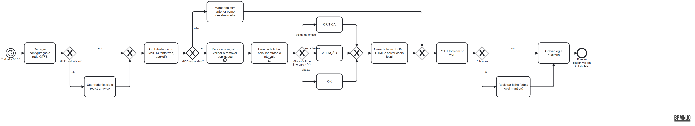
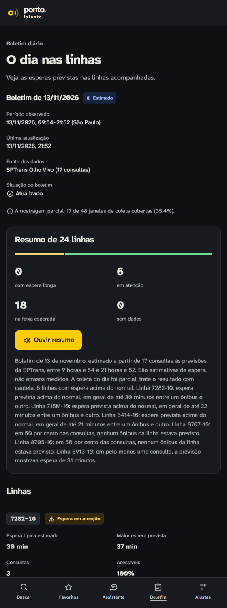

# Relatório técnico · Robotic Process Automation

**Ponto Falante · FIAP Global Solution 2026.2 · CitizenTech**
Atividade: *Do Processo Manual à Automação Inteligente* · Professores Bruno Diniz e Cibele Ribeiro

> Este arquivo é a base do PDF de entrega (exportar com os prints de `assets/`). A ordem segue os 12 itens do slide 49.

## 1. Integrantes

| Nome completo | RM |
|---|---|
| Pedro Henrique Bicas Couto | RM 99534 |
| Bryan Willian | RM 551305 |
| Felipe Masera Terra | RM 99405 |
| Gabriel Fernandes Doms | RM 98630 |
| Lucas Vassão Braga | RM 98607 |

## 2. A CitizenTech e o problema resolvido

O **Ponto Falante** é uma plataforma de acessibilidade para usuários de ônibus de São Paulo, especialmente pessoas com deficiência visual e idosos, que têm dificuldade de ler o letreiro e de usar apps de transporte. O MVP (Angular + Spring Boot + PostgreSQL, publicado em https://ponto-falante.onrender.com) mostra e fala a previsão real dos próximos ônibus (SPTrans), tem um assistente de horários e de regras de gratuidade e um boletim diário das linhas.

**Problema operacional:** para avisar os passageiros de que uma linha anda com espera longa, alguém precisaria consultar os pontos várias vezes por dia, anotar as previsões, comparar e escrever um aviso. É manual, repetitivo, sujeito a esquecimento e não escala.

## 3. Objetivo da automação e benefício ao cidadão

**Objetivo:** coletar previsões reais ao longo do dia e publicar todo dia, sem intervenção humana, um boletim por linha com dados validados, decisão explicável e origem declarada.

**Benefício:** o passageiro com baixa visão ouve, na tela do MVP, quais linhas tiveram espera longa prevista e pode sair mais cedo ou escolher outra linha. A gestora de transporte recebe a lista de linhas em atenção para conferir.

## 4. Processo e desenho do fluxo



Arquivo editável: `docs/fluxo.bpmn` (BPMN 2.0, gerado por `docs/gerar_fluxo_bpmn.py`). São dois robôs, cada um com o seu agendamento.

| Etapa | Entrada | Processamento | Saída |
|---|---|---|---|
| Coleta (8 vezes por dia) | `config/monitoramento.yaml` (6 pontos) | `GET /api/pontos/{codigo}/previsoes` no MVP; só respostas com `fonte = OLHO_VIVO` viram amostra | `POST /api/rpa/amostras` com `X-API-Key`; lote pendente em `saida/pendentes/` se falhar |
| Início do boletim (06:00) | Agendamento diário | Carrega a configuração | Configuração validada |
| Leitura | `GET /api/rpa/amostras?data=` | 3 tentativas com espera de 2, 4 e 8 s | Amostras do dia anterior |
| Validação (laço) | Cada amostra | Campos, período, ponto no escopo, previsões de 0 a 120 min, sentidos separados | Válidas + inválidas com motivo |
| Deduplicação | Válidas | Mesmo ponto e mesmo horário de consulta contam uma vez | Amostras únicas |
| Decisão (laço) | Cada linha | Espera típica, maior espera e consultas sem ônibus previsto → CRÍTICA, ATENÇÃO, OK ou SEM DADOS | Situação por linha |
| Boletim | Situações | JSON + HTML + frase para voz, com a categoria (ESTIMADO, SIMULADO ou INDISPONIVEL) | `saida/boletim_AAAA-MM-DD.*` |
| Publicação | Boletim | `POST /boletim` com `X-API-Key`; o backend confere a proveniência | `GET /boletim` e tela do MVP |
| Auditoria | Resultado | Log + `auditoria.jsonl` | Evidência da execução |

## 5. Tecnologias e justificativa

| Tecnologia | Uso | Por quê |
|---|---|---|
| Python 3.11 | Robôs | Aceito no slide 47; versionável e testável; o grupo já usa Python na IA |
| requests | HTTP com retry | Simples e padrão de mercado |
| PyYAML | Configuração | Regras e pontos editáveis sem mexer no código |
| Jinja2 | HTML do boletim | Escapa conteúdo automaticamente (segurança) |
| GitHub Actions | Agendamento | Gratuito; `rpa-coleta.yml` e `rpa-diario.yml`, com segredos fora do código |
| pytest | Testes | Cenários reproduzíveis e automáticos |
| FastAPI (mock) | Testes e demo sem backend | Mesmo contrato OpenAPI do MVP |
| bpmn.io | Fluxo | Padrão BPMN 2.0 exigido |

## 6. Regras de negócio, decisões e processamento

A Olho Vivo informa **previsões** de chegada, não chegadas observadas, e o GTFS da SPTrans descreve a maioria das linhas por frequência. Uma previsão sozinha não prova atraso. Por isso o boletim é **ESTIMADO** e mede o que o dado real sustenta: a espera prevista em cada consulta.

| Situação | Regra (limites no YAML, seção `regras_estimadas`) |
|---|---|
| CRÍTICA | espera típica prevista > 30 min |
| ATENÇÃO | espera típica > 20 min, **ou** maior espera > 30 min, **ou** sem ônibus previsto em 50% ou mais das consultas |
| OK | abaixo dos limites |
| SEM DADOS | menos de 3 consultas com previsão da linha (o robô não decide no escuro) |

- Se menos de 50% das janelas de coleta do dia foram cobertas, o boletim avisa "amostragem parcial".
- Sentidos opostos de uma linha não se somam (não reduzem a espera de quem está no ponto).
- Sem amostra real, o boletim sai como **INDISPONÍVEL**. Só com o MVP em modo demonstração o robô usa o histórico simulado, sempre rotulado. Real e simulado nunca se misturam.
- Os limites são hipóteses iniciais documentadas e ficam no YAML, para a gestora ajustar.

Execuções reais de 13/11/2026:

- Coleta em produção (GitHub Actions): 6 pontos consultados, 111 ônibus previstos em 46 linhas-ponto, 6 amostras gravadas, 0 rejeitadas.
- Boletim do dia 12/11 publicado como **INDISPONÍVEL**: a coleta ainda não existia nesse dia, e o robô não inventou números.
- Boletim do dia 13/11 (execução de 14/11): 17 consultas válidas, 24 linhas avaliadas, 6 em **ATENÇÃO** e 18 dentro dos limites, com aviso de "amostragem parcial" (17 de 48 janelas). O agendador gratuito do GitHub atrasa e pula execuções, e o boletim informa a cobertura real.
- Execução local contra a SPTrans real: 6 amostras e boletim ESTIMADO com aviso de "amostragem parcial" (`logs/rpa_2026-11-13.log`).

## 7. Tratamento de exceções e recuperação

| Exceção | Tratamento | Código |
|---|---|---|
| MVP fora ao ler as amostras | 3 tentativas com backoff; republica o último boletim marcado como **desatualizado**, com o motivo | 2 |
| Publicação recusada ou MVP fora ao publicar | Salva o boletim em `saida/` e registra a falha | 1 |
| Coletor sem acesso ao MVP | Guarda o lote em `saida/pendentes/` e reenvia na execução seguinte | 1 |
| Chave inválida (401/403) | Não insiste e orienta conferir `RPA_API_KEY` | 1 |
| Resposta fora do contrato | Descarta a consulta e registra o motivo | 0 |
| Mais da metade das amostras inconsistente | Gera o boletim com aviso de baixa confiabilidade | 0 |

Nenhuma falha é silenciosa: toda exceção aparece no log, na auditoria e, quando afeta o cidadão, no próprio boletim.

## 8. Logs e evidências de auditoria

- `logs/rpa_AAAA-MM-DD.log`: data/hora, nível, etapa e mensagem (início, recebidos, validação por motivo, decisão por linha, publicação, fim com código).
- `logs/auditoria.jsonl`: um JSON por execução com status, código de saída, estatísticas, linhas por situação, fonte dos dados, erros e duração.
- Sem dados sensíveis: o veículo chega anonimizado e a chave é mascarada por filtro.

Trecho real da coleta em produção (13/11/2026, GitHub Actions):
```
INFO | pf_rpa.coletor | Ponto 260015039: 44 ônibus previstos em 16 linhas (consultado em 2026-11-13T09:54:15-03:00)
INFO | pf_rpa.coletor | Ponto 340015323: 25 ônibus previstos em 6 linhas (consultado em 2026-11-13T09:54:17-03:00)
INFO | pf_rpa.coletor | Envio: 6 gravadas, 0 duplicadas, 0 rejeitadas
```

Trecho real do boletim sem amostras do dia:
```
INFO | pf_rpa.robo | Nenhuma amostra real válida para 2026-11-12 | modo do MVP: REAL | fallback simulado: somente_demo -> INDISPONIVEL
INFO | pf_rpa.robo | Boletim publicado no MVP (POST /boletim)
```

## 9. Integração com o MVP

O resultado é consumido por outro componente via API. O coletor lê as previsões no backend Spring Boot (que consulta a SPTrans pelo gateway da Prefeitura) e grava as amostras em PostgreSQL (`POST /api/rpa/amostras`). O robô do boletim lê essas amostras e publica em `POST /boletim`. O backend confere se a proveniência declarada bate com as amostras gravadas, guarda o boletim e o serve em `GET /boletim` para a tela do Angular, que lê o `resumo_falado` em voz alta e mostra o selo **Estimado**, **Simulado** ou **Indisponível**. Contrato: `contratos/openapi-integracao.yaml`.

Execuções no GitHub Actions: https://github.com/pedrobicas/ponto-falante/actions/workflows/rpa-coleta.yml e https://github.com/pedrobicas/ponto-falante/actions/workflows/rpa-diario.yml. Tela `/boletim` do MVP publicado em 14/11/2026, com o primeiro boletim estimado a partir de consultas reais:



## 10. Testes realizados

45 testes automatizados (`python -m pytest -v`), todos passando, também na CI a cada push. Evidências em `tests/EVIDENCIAS.md`.

| Tipo | Cenário | Resultado |
|---|---|---|
| Sucesso com dado real | Amostras reais → boletim; coletor com sucesso parcial | Boletim ESTIMADO; o coletor grava só amostras da SPTrans |
| Sucesso (simulado rotulado) | Ponta a ponta contra o mock | Boletim publicado e igual ao `GET /boletim` |
| Decisão | Perfis de espera e limites exatos | CRÍTICA, ATENÇÃO, OK e SEM DADOS conferidos |
| Sem dado real | MVP real sem amostras; coletor diante de dado de demonstração | INDISPONÍVEL, sem números inventados; simulação nunca gravada como real |
| Falha | MVP fora, chave recusada, publicação fora, retry | Boletim anterior marcado como desatualizado; lote pendente reenviado; esperas 2, 4, 8 s |
| Segurança | Chave no log | Mascarada |

## 11. Segurança e LGPD

- Não há dado pessoal no processo: só previsões de ônibus; veículo anonimizado por hash.
- `RPA_API_KEY` e `MVP_URL` só em variáveis de ambiente e nos Secrets do GitHub; `.gitignore` bloqueia `.env`.
- Publicação e gravação autenticadas por chave; HTML gerado com escape automático.
- Pessoa no circuito: o boletim recomenda que a gestora confira as linhas em atenção antes de agir.
- **Origem dos dados:** real (consultas à SPTrans com data e hora), estimado (esperas calculadas a partir de previsões, nunca atrasos medidos), simulado (só em modo demonstração, sempre rotulado) e indisponível (sem dados, sem números).

## 12. Links

- Repositório GitHub: https://github.com/pedrobicas/ponto-falante (pasta `rpa/`)
- MVP publicado: https://ponto-falante.onrender.com/boletim
- Vídeo demonstrativo (até 3 min): [preencher após a gravação]
