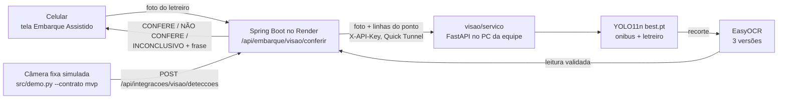

# Guia de integração: componente Visão do Ponto Falante

> **Estado em 17/11/2026: integrado ao MVP publicado.** A conferência do letreiro pelo celular no Embarque Assistido
> (https://ponto-falante.onrender.com/embarque) usa este modelo. As seções 0 a 0.5 descrevem essa integração; as
> seções 1 a 7 são o guia original da equipe (câmera fixa e API falsa), que continua valendo.

## 0. Como a visão entra no MVP



Dois usos do mesmo modelo:

| Uso | Quem chama | Contrato |
|---|---|---|
| **Conferência pelo celular** (principal) | O backend, quando a pessoa toca em "Conferir letreiro" | `POST /v1/letreiro` deste serviço ([contrato](../contratos/openapi-visao-letreiro.yaml)) |
| **Câmera fixa do ponto** (simulada com vídeo/fotos) | `src/demo.py --contrato mvp` | `POST /api/integracoes/visao/deteccoes` do MVP ([contrato](../contratos/openapi-mvp.yaml)) |

### 0.1 Onde o modelo roda (e por quê)

| Opção | Medição / limite | Decisão |
|---|---|---|
| No servidor do Render (plano gratuito) | O modelo carregado ocupa **~1,5 GB de RAM** na CPU (medido em 17/11 com as 6 fotos de demonstração); o Render gratuito tem 512 MB, já usados pelo Spring | Não cabe |
| No navegador (ONNX/WebAssembly) | O YOLO caberia, mas o EasyOCR (CRAFT + reconhecedor) não tem versão web; trocar o OCR invalidaria as métricas do relatório | Não adotado |
| **Serviço local no PC da equipe, publicado por túnel** | O PC da apresentação tem placa AMD (sem CUDA), então roda na CPU: **2,8 a 6,4 s por foto** (medido em 17/11 com as 6 fotos de demonstração; 53 testes com o modelo real passando). Com placa NVIDIA, o `instalar.ps1` usa CUDA sozinho e fica bem mais rápido. Mesmo caminho já usado pela GenAI | **Adotado** |

Fallback: sem o PC ligado, `GET /api/status` mostra `visao: INDISPONIVEL` (ou `NAO_CONECTADA` se nunca foi
registrado), a tela diz "indisponível agora" e não abre a câmera. Nenhum resultado é simulado.

### 0.2 Ligar no PC (Windows)

```powershell
# uma vez: cria .venv-visao com PyTorch (CUDA se houver NVIDIA), YOLO, EasyOCR e FastAPI
powershell.exe -NoProfile -ExecutionPolicy Bypass -File scripts/visao/instalar.ps1
# sempre que for usar pelo site: sobe o serviço em 127.0.0.1:8090, abre o túnel e registra no Render
powershell.exe -NoProfile -ExecutionPolicy Bypass -File scripts/visao/iniciar.ps1 -TunelRapido
powershell.exe -NoProfile -File scripts/visao/status.ps1
powershell.exe -NoProfile -File scripts/visao/parar.ps1
```

Chave: o Render usa `PF_VISAO_SERVICO_CHAVE` e, se ela estiver vazia, a `GENAI_API_KEY` (o PC já tem essa chave em
`scripts/genai/.env.local`). Para separar as chaves, defina `PF_VISAO_SERVICO_CHAVE` no Render e em
`scripts/visao/.env.local` com o mesmo valor.

Uso local, sem Render: `iniciar.ps1` sem `-TunelRapido` e `PF_VISAO_URL=http://127.0.0.1:8090` no Spring.

### 0.3 O que muda na leitura para o celular

O pipeline é o mesmo do relatório (`DetectorOnibus` + `ler_linha`). O serviço liga três regras a mais, só nesse uso:

1. **Casamento exato com as linhas do ponto** (depois de normalizar O/0, I/1, S/5, B/8, G/6...). No teste ponta a
   ponta de 17/11, a foto de um 647P-10 conferida no ponto da Av. Paulista (que não tem essa linha) "casava" com
   478P-10 no limiar original de 0,75. Com o casamento exato, um código legível que não está na lista volta como
   leitura **não validada**, com a confiança reduzida em 40%, e o backend compara o texto exato.
2. **Ambiguidade**: se duas linhas de número diferente ficam quase empatadas, nenhuma é afirmada.
3. **Sem sufixo inventado**: se o letreiro mostrou só "2100", o serviço devolve "2100" e o backend responde
   "número confere, confirme o destino", em vez de afirmar "2100-10".

O backend afirma algo a partir de confiança 0,45, o mesmo limiar por quadro do `Anunciador`. Na avaliação do
relatório, as leituras validadas tiveram 0 linha errada em qualquer confiança.

### 0.4 Segurança e privacidade

- `POST /v1/letreiro` exige `X-API-Key` (comparação em tempo constante); só o backend conhece a chave.
- O backend só aceita registrar `https://*.trycloudflare.com` e antes confere `/health` (modelo carregado) e um
  desafio HMAC em `/identidade` (prefixo `pf-visao-identidade:`), sem a chave trafegar.
- Imagem só JPEG/PNG (conferido pelo conteúdo), até 2 MB e 4096 px; uma inferência por vez (503 se ocupado).
- Nenhuma foto é gravada (nem pelo serviço, nem pelo backend). O log tem só tempos e contagens.

### 0.5 Testes

| Teste | O que prova |
|---|---|
| `tests/test_servico.py` (CI) | Contrato HTTP: chave, limites, formato da resposta, casamento exato, linha fora da lista, ambiguidade, sufixo |
| `tests/test_servico_modelo_real.py` (`PF_VISAO_TESTE_REAL=1`) | Modelo real pelo HTTP nas 6 fotos: 5 linhas certas, 0 afirmação no letreiro só com destino, 647P-10 não vira 478P-10 |
| `tests/test_cliente_api_mvp.py` (CI) | Câmera fixa no contrato do MVP, inclusive "sem linha lida" e fila quando a chave falha |
| `backend/.../VisaoContratoPostgresTest`, `EnderecoVisaoTest`, `ConferirLinhasDoPontoTest` | Backend: envio da foto, registro do túnel, linhas enviadas ao modelo, frases de orientação |
| `scripts/integracao/validar_visao.py` | Navegador: câmera (alimentada por foto real) -> Spring -> modelo real -> resultado falado, com axe |

---

Este pacote é a parte de **visão computacional** do Ponto Falante. Ele recebe imagens de uma câmera
(vídeo, webcam ou pasta de fotos), detecta o ônibus, lê a linha no letreiro e **envia o resultado para a
API da plataforma**. A plataforma usa esse resultado para mostrar e falar o anúncio ao passageiro.

A visão **não guarda nem envia imagens**: só manda o JSON com a linha lida.

## 1. O que a plataforma precisa expor

A visão conversa com a plataforma por dois endpoints HTTP. Basta a API da plataforma atender a este contrato.

### `GET /pontos/{codigo}/previsoes`
Devolve as linhas que passam no ponto. A visão usa essa lista para **validar o OCR**: só anuncia uma linha que
esteja nela. O resultado fica em cache por 60 s.

Formatos aceitos (o único campo lido é `linha`):
```json
[{"linha": "8000-10"}, {"linha": "875A-10"}]
```
ou
```json
{"previsoes": [{"linha": "8000-10"}, {"linha": "875A-10"}]}
```
Use o **código da linha no formato da SPTrans**, como aparece no letreiro: `8000-10`, `875A-10`, `N101-11`.
Campos extras (minutos, sentido etc.) são ignorados.

### `POST /deteccoes`
A visão envia um anúncio por ônibus:
```json
{"ponto": "260015039", "linha_lida": "8000-10", "confianca": 0.79, "criado_em": "2026-11-17T12:09:11+00:00"}
```
- `linha_lida` = `null` significa **"chegou um ônibus, mas não consegui ler a linha"**. A plataforma deve
  anunciar algo como *"Ônibus chegando. Não consegui ler a linha."*, e **não** inventar uma linha.
- `confianca` vai de 0 a 1.
- Qualquer resposta 2xx é considerada sucesso.

> Para testar sem a plataforma, `src/api_fake.py` implementa exatamente esse contrato.

## 2. Instalação

Python 3.10–3.12. GPU NVIDIA é opcional (na CPU funciona, só mais devagar).
```bash
python -m venv .venv
.venv\Scripts\activate            # Linux/Mac: source .venv/bin/activate
pip install ultralytics easyocr opencv-python numpy requests
```
(O `requirements.txt` completo também instala ferramentas de treino e relatório, que não são necessárias
para a integração.)

Na primeira execução, o EasyOCR baixa os modelos dele (~100 MB) do GitHub oficial.

## 3. Teste rápido (5 minutos, sem a plataforma)
```bash
# terminal 1: API falsa com as linhas do ponto
python src/api_fake.py --linhas "647P-10,5109-10,2100-10,288,695H-10"

# terminal 2: câmera simulada com as 6 fotos de exemplo
python src/demo.py --fonte amostras/imagens/demo --ponto 260015039 --repetir-imagem 30 --saida teste.mp4
```
O terminal 1 deve mostrar 6 linhas `Detecção recebida`: cinco com a linha certa e uma com `linha_lida: None`,
de um ônibus cujo letreiro mostrava só o destino. Acrescente `--gpu` se houver placa NVIDIA.

## 4. Ligando na plataforma

Aponte a visão para a API real pela variável de ambiente ou pelo parâmetro `--api`:
```bash
set PONTO_FALANTE_API=https://sua-plataforma.com      # Linux/Mac: export PONTO_FALANTE_API=...
python src/demo.py --fonte 0 --ponto 260015039        # 0 = webcam; também aceita arquivo de vídeo ou URL RTSP
```

| Parâmetro do `demo.py` | Para quê |
|---|---|
| `--fonte` | `0` (webcam), caminho de vídeo, URL da câmera ou pasta de imagens |
| `--ponto` | código do ponto na plataforma (vai no GET e no POST) |
| `--api` | URL da API (sobrepõe `PONTO_FALANTE_API`; padrão `http://localhost:8000`) |
| `--sem-api` + `--linhas` | roda sem API, com as linhas informadas à mão |
| `--gpu` | usa a GPU no OCR |
| `--saida arquivo.mp4` | grava o vídeo anotado (já anonimizado) |
| `--mostrar` | abre uma janela com o vídeo (precisa do `opencv-python` com interface gráfica) |

### Usando como biblioteca (dentro do código da plataforma)
```python
import sys, time, cv2
sys.path.insert(0, "src")
from detector import DetectorOnibus
from anunciador import Anunciador
from cliente_api import ClienteAPI

PONTO = "260015039"
detector = DetectorOnibus("modelos/best.pt", conf=0.35, gpu=False)
anunciador = Anunciador()                         # votação entre quadros
api = ClienteAPI("https://sua-plataforma.com")

cap = cv2.VideoCapture(0)
while True:
    ok, frame = cap.read()
    if not ok:
        break
    linhas = api.linhas_do_ponto(PONTO)           # GET (com cache)
    resultado = detector.detectar(frame, linhas)  # YOLO + OCR
    anuncio = anunciador.processar(resultado, time.time())
    if anuncio:                                   # só quando há certeza suficiente
        print(anuncio.texto)                      # "Ônibus da linha 8000-10 chegando."
        api.enviar_deteccao(PONTO, anuncio.linha, anuncio.confianca)   # POST
```

## 5. Comportamentos importantes

- **Só anuncia o que tem certeza.** O ônibus precisa aparecer em vários quadros e a mesma linha precisa ser
  lida pelo menos 2 vezes. Sem isso, o anúncio sai com `linha_lida: null`.
- **Não repete.** A mesma linha não é anunciada de novo em menos de 20 s.
- **API fora do ar não trava a câmera.** O POST que falhar vai para `fila_deteccoes.jsonl` e é reenviado
  depois. Se o GET falhar, a visão usa a última lista válida.
- **Privacidade (LGPD).** Tudo que é exibido ou gravado tem rostos borrados (modelo YuNet em
  `modelos/face_detection_yunet_2023mar.onnx`) e a faixa da placa do ônibus borrada.
- **Log** em `logs/visao.log`.

## 6. Desempenho e limitações

- Detector (YOLO11n, `modelos/best.pt`): mAP50 de 0,866 no teste e 7,8 ms por imagem na GPU.
- Leitura da linha em um único quadro: 44% de acerto nos letreiros que mostram o código, **0 linhas erradas** e
  0 anúncios falsos em letreiros que mostram só o destino. Com vários quadros (câmera real), a chance de leitura
  aumenta.
- Os letreiros de SP alternam entre código e destino: em parte dos quadros não há código para ler, e isso é
  esperado.
- Desempenho completo (detecção + OCR em 3 versões): cerca de 4 quadros/s na GPU; na CPU é mais lento. Para uma
  câmera em tempo real, processar 2 a 4 quadros por segundo já é suficiente.
- Treinado só com fotos de dia de ônibus de São Paulo (Wikimedia Commons); noite e chuva não foram testados.

## 7. O que tem no pacote

| Pasta/arquivo | Conteúdo |
|---|---|
| `src/` | código da visão (`detector`, `leitor_letreiro`, `anunciador`, `cliente_api`, `privacidade`, `demo`, `api_fake`) |
| `modelos/best.pt` | pesos do detector treinado (ônibus + letreiro) |
| `modelos/face_detection_yunet_2023mar.onnx` | detector de rostos para anonimização |
| `amostras/imagens/demo/` | 6 fotos para teste (Wikimedia Commons; créditos em `docs/creditos_imagens.csv`) |
| `tests/` | testes automatizados (`pytest -q`) |
| `ferramentas/`, `notebooks/`, `relatorio/` | coleta, rotulagem, treino, avaliação e gerador do relatório |
| `resultados/` | métricas, gráficos, vídeo da demo e relatório PDF |
| `README.md`, `docs/` | documentação completa, dataset e licenças |
