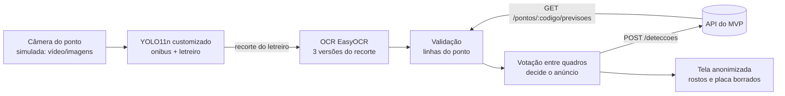

# Ponto Falante · Visão Computacional

**Global Solution 2026.2 · CitizenTech · Applied Computer Vision — "Enxergando o mundo real"**

Componente **Visão** do MVP *Ponto Falante*: detecta o ônibus que chega ao ponto, encontra o **letreiro**,
lê o número da linha e envia o resultado para a API do MVP, que anuncia em voz alta para passageiros com
deficiência visual ou baixa visão.

## Integrantes
| Nome | RM |
|---|---|
| Bryan Willian | RM551305 |
| Felipe Terra | RM99405 |
| Gabriel Doms | RM98630 |
| Lucas Vassão Braga | RM98607 |
| Pedro Bicas | RM99534 |

- Vídeo de demonstração: [link do YouTube (não listado)]
- Relatório: [`resultados/Relatorio_Visao_Ponto_Falante.pdf`](resultados/Relatorio_Visao_Ponto_Falante.pdf)
- Demo gravada pelo sistema: [`resultados/demo.mp4`](resultados/demo.mp4)
- **Integração com a plataforma:** [`INTEGRACAO.md`](INTEGRACAO.md)

## Resultados
| Métrica (conjunto de teste, imagens nunca vistas no treino) | Valor |
|---|---|
| mAP50 geral / ônibus / letreiro | **0,866** / 0,906 / 0,826 |
| mAP50-95 geral | 0,599 |
| Precisão / recall geral | 0,875 / 0,828 |
| Inferência por imagem (YOLO11n, RTX 4060 Ti) | 7,8 ms |
| OCR: letreiros com código lidos certo (1 quadro) | 11 de 25 (44%) |
| OCR: linha errada anunciada | **0** |
| Letreiros só com destino em que o sistema anunciou linha (falso anúncio) | **0 de 16** |

Todos os números estão em [`resultados/metricas.json`](resultados/metricas.json); o detalhe de cada letreiro está
em [`resultados/ocr_detalhes.csv`](resultados/ocr_detalhes.csv).

## Como funciona



1. **Detecção** — YOLO11 nano treinado com 2 classes customizadas: `onibus` e `letreiro`, só com fotos de
   ônibus da cidade de São Paulo (ver [Dataset](#dataset)).
2. **Leitura** — o letreiro é recortado e lido por OCR em três versões (colorida, suavizada para juntar os pontos
   do LED e com contraste CLAHE).
3. **Validação** — o texto só vira linha se casar com uma linha que passa no ponto (tolerante a O/0, I/1, S/5, B/8).
4. **Decisão** — votação entre vários quadros; sem leitura confiável, avisa *"Ônibus chegando. Não consegui ler a linha."*
5. **Integração** — envia `{"ponto", "linha_lida", "confianca", "criado_em"}` para `POST /deteccoes`.
   API fora do ar → fila local e reenvio depois.
6. **LGPD** — nenhuma imagem é enviada ou guardada; o que é exibido/salvo tem rostos e placa borrados.

> **Protótipo funcional:** a câmera instalada no ponto é simulada com imagens de teste passadas quadro a quadro.
> O modelo, o OCR, a decisão e a integração rodam de verdade.

## Dataset
Não existe dataset público de ônibus e letreiros **de São Paulo** rotulados, e não havia tempo para rotular à mão.
Então reutilizamos fotos da internet, com rotulagem automática e revisão humana (detalhes em
[`docs/dataset.md`](docs/dataset.md)):

1. **Coleta** — 342 fotos de ônibus da capital com licença livre do Wikimedia Commons
   ([`ferramentas/baixar_commons.py`](ferramentas/baixar_commons.py)); autor e licença de cada uma em
   [`docs/creditos_imagens.csv`](docs/creditos_imagens.csv).
2. **Pré-rotulagem** — modelos "professores" geram as caixas: YOLO11x (ônibus) e Grounding DINO (letreiro), com
   filtros geométricos ([`ferramentas/pre_rotular.py`](ferramentas/pre_rotular.py)).
3. **Revisão humana** — folhas de miniaturas conferidas; 13 fotos descartadas com motivo
   ([`ferramentas/revisao_descartes.txt`](ferramentas/revisao_descartes.txt)).
4. **Treino** — 198 imagens (138/39/21), YOLO11n, sem espelhamento ([`ferramentas/treinar.py`](ferramentas/treinar.py)).
5. **Avaliação do OCR** — gabarito lido à mão ([`resultados/gabarito_ocr.csv`](resultados/gabarito_ocr.csv)),
   avaliado por [`ferramentas/avaliar_ocr.py`](ferramentas/avaliar_ocr.py).

## Estrutura
```
ferramentas/baixar_commons.py   passo 1: baixa as fotos de SP do Wikimedia Commons (licenças livres + créditos)
ferramentas/pre_rotular.py      passo 2: pré-rotulagem com YOLO11x + Grounding DINO e folhas de revisão
ferramentas/revisao_descartes.txt passo 3: fotos descartadas na revisão humana
ferramentas/treinar.py          passo 4: monta o dataset, treina o YOLO11n e avalia no teste
ferramentas/avaliar_ocr.py      passo 5: avalia a leitura da linha contra o gabarito
notebooks/01_treino_yolo_colab.ipynb  versão alternativa do treino para o Google Colab
src/detector.py        YOLO + OCR por frame
src/leitor_letreiro.py extrai e valida a linha a partir do texto do OCR
src/anunciador.py      votação entre quadros e frase do anúncio
src/cliente_api.py     integração com a API do MVP (timeout, retry, fila local)
src/privacidade.py     borra rostos e região da placa
src/demo.py            demonstração em tempo real (vídeo, pasta de imagens ou webcam)
src/api_fake.py        API falsa com o mesmo contrato, para testar sem o MVP
relatorio/             gerador do relatório PDF (lê resultados/metricas.json) e info.txt
docs/                  dataset e licenças, créditos das imagens, roteiro do vídeo
tests/                 testes automatizados (pytest)
modelos/best.pt        pesos treinados do YOLO11n (5 MB)
modelos/face_detection_yunet_2023mar.onnx  detector de rostos (OpenCV Zoo) para anonimização
resultados/            métricas, gráficos, exemplos, demo.mp4 e relatório PDF
```

## Passo a passo para reproduzir

### 1. Instalar
```bash
python -m venv .venv && source .venv/bin/activate      # Windows: .venv\Scripts\activate
pip install -r requirements.txt
```

### 2. Dataset, treino e avaliação (GPU recomendada)
```bash
python ferramentas/baixar_commons.py                   # ~342 fotos de SP + créditos
python ferramentas/pre_rotular.py --conf-letreiro 0.15 # rótulos automáticos + folhas em dados/revisao/
# confira as folhas e liste os descartes em ferramentas/revisao_descartes.txt
python ferramentas/treinar.py                          # modelos/best.pt + resultados/metricas.json
python ferramentas/avaliar_ocr.py                      # OCR contra resultados/gabarito_ocr.csv
```
Os pesos já treinados estão em `modelos/best.pt`: para só rodar a demo, pule esta etapa.

### 3. Rodar a demonstração
```bash
# terminal 1 — API falsa com as linhas do ponto (ou aponte PONTO_FALANTE_API para o MVP do grupo)
python src/api_fake.py --linhas "647P-10,5109-10,2100-10,288,695H-10,8000-10"

# terminal 2 — câmera simulada (pasta de imagens; também aceita vídeo ou webcam: --fonte 0)
python src/demo.py --fonte amostras/imagens/demo --ponto 260015039 --saida resultados/demo.mp4 --repetir-imagem 30 --gpu
python src/demo.py --fonte amostras/imagens/demo --sem-api --linhas "647P-10,5109-10"   # sem API
```
A pasta `amostras/imagens/demo` traz 6 fotos do Wikimedia Commons ([créditos](amostras/imagens/demo/CREDITOS.md)).
Variáveis de ambiente: `PONTO_FALANTE_API` (URL da API, padrão `http://localhost:8000`).
Logs em `logs/visao.log`.

### 4. Testes
```bash
pytest -q
```

### 5. Relatório
```bash
python relatorio/gerar_relatorio.py --resultados resultados --saida resultados/Relatorio_Visao_Ponto_Falante.pdf
```
Preencha antes `relatorio/info.txt` (integrantes, links).

## Integração com o MVP
O modelo está integrado ao Ponto Falante publicado: a tela de Embarque Assistido usa a câmera do celular para
conferir o letreiro com este modelo, servido por [`servico/app.py`](servico/app.py). Arquitetura, decisão de onde
o modelo roda, como ligar no PC e testes: [`INTEGRACAO.md`](INTEGRACAO.md).

| Chamada | Uso |
|---|---|
| `POST /v1/letreiro` (servico/app.py) | o backend envia a foto do celular e as linhas do ponto; recebe a leitura ([contrato](../contratos/openapi-visao-letreiro.yaml)) |
| `GET /pontos/{codigo}/previsoes` | contrato da equipe (api_fake): linhas do ponto, para validar o OCR (cache de 60 s) |
| `POST /deteccoes` | contrato da equipe: `{"ponto": str, "linha_lida": str \| null, "confianca": float, "criado_em": ISO-8601}` |
| `POST /api/integracoes/visao/deteccoes` | câmera fixa no MVP real: `demo.py --contrato mvp` (chave em `VISAO_API_KEY`) |

## Créditos e licenças
Fotos: Wikimedia Commons (domínio público, CC0, CC BY, CC BY-SA), com autor, licença e URL de cada uma em
[`docs/creditos_imagens.csv`](docs/creditos_imagens.csv). O dataset não é redistribuído no repositório (o script
`baixar_commons.py` o obtém da fonte original); só as 6 fotos de demonstração, com créditos em
[`amostras/imagens/demo/CREDITOS.md`](amostras/imagens/demo/CREDITOS.md).
Modelos de terceiros: YOLO11 (Ultralytics, AGPL-3.0), Grounding DINO (IDEA-Research, Apache-2.0),
EasyOCR (Apache-2.0), YuNet (OpenCV Zoo, MIT).
